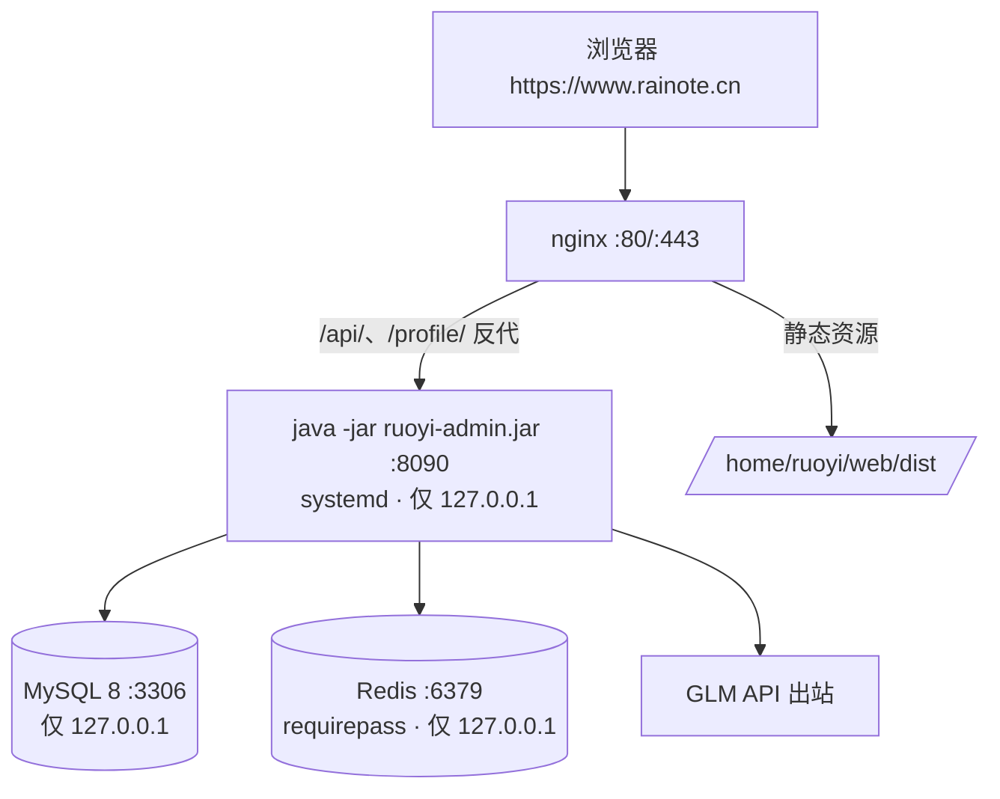

# Rainote 阿里云 ECS 部署手册

单机直跑形态：nginx（80/443）托管前端静态资源并反代 `/api` → 后端 jar（systemd，仅监听本机 8090）→ 同机 MySQL 8 / Redis。



**前置条件**：ECS（CentOS / Alibaba Cloud Linux 系，2核4G+）、域名 rainote.cn 已备案、DNS A 记录已指向 ECS 公网 IP、阿里云 RAM 账号可创建子账号（用于证书 DNS 验证）。

**代码侧改造已完成**（仓库内）：生产配置 `ruoyi-admin/src/main/resources/application-prod.yml`（敏感值经环境变量注入、关闭 druid 监控台与 swagger）、前端 API 基址统一 `notepad/src/config/api.ts`（恒定 `/api`）、20 张 note_* 表结构 `sql/note_schema.sql`。

---

## 1. 本地准备（Windows 开发机）

### 1.1 改口令（迁移前完成，随数据带走）

- **admin 登录密码**：本地启动应用 → 个人中心改为强密码（或 SQL 改 `sys_user` 后随 dump 迁移）。
- 准备四个强口令（记好，后面都用）：`DB_PASS`（MySQL rainote 用户）、`REDIS_PASS`、`TOKEN_SECRET`（≥32 位随机串）、GLM key（已有）。

### 1.2 构建产物

```powershell
# 后端 jar（约 3 分钟）
mvn -pl ruoyi-admin -am package -DskipTests -q
# 产物：ruoyi-admin/target/ruoyi-admin.jar

# 前端
cd notepad; npm run build
# 产物：notepad/dist/（含 .gz 预压缩文件）
```

### 1.3 导出全量数据（结构+数据）

```powershell
mysqldump -uroot -p --single-transaction --set-gtid-purged=OFF --default-character-set=utf8mb4 -B ry-vue -r C:\temp\rainote-data.sql
```

### 1.4 打包上传目录

```powershell
Compress-Archive -Path D:\ruoyi\uploadPath\* -DestinationPath C:\temp\uploadPath.zip
```

### 1.5 传输到服务器（替换 `<ECS_IP>`）

```powershell
scp C:\temp\rainote-data.sql C:\temp\uploadPath.zip root@<ECS_IP>:/root/
scp ruoyi-admin\target\ruoyi-admin.jar root@<ECS_IP>:/root/
scp -r notepad\dist root@<ECS_IP>:/root/dist
# 仓库 SQL 初始化脚本（若未随 git 同步到服务器，一并传）
scp sql\ry_20220822.sql sql\note_schema.sql root@<ECS_IP>:/root/sqlinit/
```

> 后续所有服务器命令都在 ECS 上以 root 执行（`ssh root@<ECS_IP>`）。

---

## 2. 服务器初始化

```bash
# 系统更新 + 基础工具
yum update -y && yum install -y wget zip unzip cronie

# JDK 8
yum install -y java-1.8.0-openjdk java-1.8.0-openjdk-devel && java -version

# nginx
yum install -y nginx && systemctl enable --now nginx

# Redis（先装后配）
yum install -y redis

# MySQL 8（Alibaba Cloud Linux 3 / el8；CentOS 7 换 el7 包名）
yum install -y https://repo.mysql.com/mysql80-community-release-el8-1.noarch.rpm
yum module disable mysql -y 2>/dev/null; yum install -y mysql-community-server
systemctl enable --now mysqld
grep 'temporary password' /var/log/mysqld.log   # 首次 root 临时密码
mysql -uroot -p --connect-expired-password -e "ALTER USER 'root'@'localhost' IDENTIFIED BY '<ROOT强密码>';"
```

### 2.1 MySQL 安全配置

```bash
# /etc/my.cnf [mysqld] 段确认（默认即安全，显式为准）
#   bind-address = 127.0.0.1
#   character-set-server = utf8mb4
# 追加后重启 mysqld
systemctl restart mysqld

# 建库 + 专用账号（替换 <DB_PASS>）
mysql -uroot -p <<'EOF'
CREATE DATABASE `ry-vue` DEFAULT CHARACTER SET utf8mb4 COLLATE utf8mb4_general_ci;
CREATE USER 'rainote'@'127.0.0.1' IDENTIFIED BY '<DB_PASS>';
GRANT ALL PRIVILEGES ON `ry-vue`.* TO 'rainote'@'127.0.0.1';
FLUSH PRIVILEGES;
EOF
```

### 2.2 Redis 安全配置

```bash
# /etc/redis.conf 修改：
#   bind 127.0.0.1
#   requirepass <REDIS_PASS>
systemctl enable --now redis && systemctl restart redis
```

---

## 3. 数据库初始化与数据迁移

```bash
mkdir -p /root/sqlinit   # 若 1.5 已传脚本则跳过
mysql -uroot -p ry-vue --default-character-set=utf8mb4 < /root/sqlinit/ry_20220822.sql   # sys_*/gen_* 基础表 + 初始账号
# 菜单脚本（在仓库 sql/ 目录，按需全量执行一次）
for f in /root/sqlinit/*Menu.sql; do mysql -uroot -p ry-vue --default-character-set=utf8mb4 < "$f"; done
mysql -uroot -p ry-vue --default-character-set=utf8mb4 < /root/sqlinit/note_schema.sql   # note_* 表结构
mysql -uroot -p ry-vue --default-character-set=utf8mb4 < /root/rainote-data.sql          # 全量数据（含改好的 admin 密码）
mysql -uroot -p -e "SELECT COUNT(*) FROM \`ry-vue\`.note_note;"   # 迁移验证：笔记数 > 0
```

---

## 4. 后端部署（systemd）

```bash
mkdir -p /home/ruoyi/app /home/ruoyi/web /home/ruoyi/uploadPath /home/ruoyi/logs /home/ruoyi/backup

# 备份落盘目录权限收口（应用内整机备份包/还原前快照写此目录，含全库数据与密码哈希；
# 第 8 节 cron 每日 dump 亦落此目录）。rainote.service 以 root 运行即属主 root，
# 若后续改用专用账户运行服务，chown 需同步改为该账户
chown root:root /home/ruoyi/backup && chmod 700 /home/ruoyi/backup

mv /root/ruoyi-admin.jar /home/ruoyi/app/
unzip -o /root/uploadPath.zip -d /home/ruoyi/uploadPath/   # 既有附件就位
mv /root/dist /home/ruoyi/web/dist

# 环境变量文件（权限 600，替换四个值）
cat > /home/ruoyi/app/rainote.env <<'EOF'
RAINOTE_DB_USER=rainote
RAINOTE_DB_PASSWORD=<DB_PASS>
RAINOTE_REDIS_PASSWORD=<REDIS_PASS>
RAINOTE_TOKEN_SECRET=<TOKEN_SECRET>
GLM_API_KEY=<你的GLM密钥>
EOF
chmod 600 /home/ruoyi/app/rainote.env

cat > /etc/systemd/system/rainote.service <<'EOF'
[Unit]
Description=Rainote backend (RuoYi)
After=network.target mysqld.service redis.service

[Service]
User=root
WorkingDirectory=/home/ruoyi/app
EnvironmentFile=/home/ruoyi/app/rainote.env
ExecStart=/usr/bin/java -Dfile.encoding=UTF-8 -Duser.timezone=Asia/Shanghai -Xms512m -Xmx1024m -jar /home/ruoyi/app/ruoyi-admin.jar --spring.profiles.active=druid,prod
Restart=always
RestartSec=5

[Install]
WantedBy=multi-user.target
EOF

systemctl daemon-reload && systemctl enable --now rainote
sleep 20 && systemctl status rainote --no-pager
curl -s http://127.0.0.1:8090/ | head -c 200    # 有响应即通（404/401 页面都算通）
tail -50 /home/ruoyi/logs/sys-*.log             # 无 ERROR 即可
```

---

## 5. 前端部署与 nginx 配置

```bash
cat > /etc/nginx/conf.d/rainote.conf <<'EOF'
# 还原上传通道限速（U3）：按客户端 IP 1r/s + burst 5——匿名可达的大请求体是资源耗尽
# 放大器，后端 @RateLimiter 晚于 multipart 落盘生效，nginx 层先限速收口。
# 此指令须在 http 上下文（conf.d/*.conf 被含入 http 块，置文件顶部即可）。
limit_req_zone $binary_remote_addr zone=restore_limit:10m rate=1r/s;

server {
    listen 80;
    server_name www.rainote.cn rainote.cn;
    return 301 https://www.rainote.cn$request_uri;
}

server {
    listen 443 ssl http2;
    server_name www.rainote.cn rainote.cn;

    # 证书路径（第 6 步 acme.sh 签发后生效；先注释这两行做 HTTP-only 联调也行）
    ssl_certificate     /home/ruoyi/cert/www.rainote.cn/fullchain.cer;
    ssl_certificate_key /home/ruoyi/cert/www.rainote.cn/www.rainote.cn.key;
    ssl_protocols TLSv1.2 TLSv1.3;

    # 上传上限 512m：还原上传通道需要（整机备份包可达数百 MB，与后端 multipart
    # 512MB 配套）。server 块内影响全部路由——/common/upload 等已鉴权通道同享
    # 此上限属滥用面非漏洞（Risks 已评估）。
    client_max_body_size 512m;

    # 真实客户端 IP 说明：当前直连形态 $remote_addr 即真实客户端 IP，无需额外配置。
    # 接入 SLB/CDN 后必须收口（否则 XFF 可伪造，污染 limit_req 键与后端 @RateLimiter
    # IP 计数），届时取消注释并填可信代理网段：
    # set_real_ip_from <SLB 回源网段>;
    # real_ip_header X-Forwarded-For;
    # real_ip_recursive on;

    gzip_static on;

    # 数据还原上传通道（U3）：限速后转发，须置于 /api/ 之前（最长前缀优先匹配）
    location /api/system/note/restore {
        limit_req zone=restore_limit burst=5 nodelay;
        proxy_pass http://127.0.0.1:8090/;
        proxy_set_header Host $host;
        proxy_set_header X-Real-IP $remote_addr;
        proxy_set_header X-Forwarded-For $proxy_add_x_forwarded_for;
        proxy_set_header X-Forwarded-Proto $scheme;
        proxy_read_timeout 1800s;    # 还原执行含还原前快照生成，可达分钟级
    }

    location /api/ {
        proxy_pass http://127.0.0.1:8090/;
        proxy_set_header Host $host;
        proxy_set_header X-Real-IP $remote_addr;
        proxy_set_header X-Forwarded-For $proxy_add_x_forwarded_for;
        proxy_set_header X-Forwarded-Proto $scheme;
        proxy_buffering off;          # AI 聊天 SSE 流式响应
        proxy_read_timeout 300s;
    }

    # 上传文件静态映射（后端 /profile/** 直出）
    location /profile/ {
        proxy_pass http://127.0.0.1:8090/profile/;
        proxy_set_header Host $host;
    }

    location / {
        root /home/ruoyi/web/dist;
        try_files $uri $uri/ /index.html;   # history 路由 fallback
    }
}
EOF
nginx -t && systemctl reload nginx
```

---

## 6. HTTPS 证书（acme.sh + 阿里云 DNS，自动续签）

免费证书现在**90 天有效期**（每自然年 20 张额度），acme.sh 全自动续签一劳永逸。

```bash
# 1) RAM 子账号：阿里云控制台 → RAM 访问控制 → 创建用户（仅编程访问），
#    授权 AliyunDNSFullAccess，记下 AccessKey ID / Secret

# 2) 安装 acme.sh
curl https://get.acme.sh | sh -s email=my@rainote.cn
source ~/.bashrc

# 3) 签发（DNS API 验证，无需停 nginx）
export Ali_Key="<AccessKey ID>"
export Ali_Secret="<AccessKey Secret>"
acme.sh --issue --dns dns_ali -d www.rainote.cn -d rainote.cn --keylength ec-256

# 4) 部署证书到 nginx（自动 reload + 自动续签已内置 cron）
mkdir -p /home/ruoyi/cert
acme.sh --install-cert -d www.rainote.cn --ecc \
  --fullchain-file /home/ruoyi/cert/www.rainote.cn/fullchain.cer \
  --key-file       /home/ruoyi/cert/www.rainote.cn/www.rainote.cn.key \
  --reloadcmd      "systemctl reload nginx"

curl -sI https://www.rainote.cn | head -3    # HTTP/2 200
```

> 备选（不装 acme.sh）：阿里云控制台 → 数字证书管理服务 → 免费证书（20 张/年，90 天）→ 手动下载 nginx 格式上传到 `/home/ruoyi/cert/`。每 90 天记得手动换一次，忘了站点报证书过期。

---

## 7. 安全收口

```bash
# ECS 安全组（阿里云控制台）：入方向仅保留
#   443/80   0.0.0.0/0
#   22       你的常用 IP/32（收紧 SSH）
#   删除其余全部放行（3306/6379/8090 本就不应对外）

# 服务器防火墙双保险（可选）
firewall-cmd --permanent --add-service=https --add-service=http && firewall-cmd --reload

# 确认三个端口都只听本机
ss -tlnp | grep -E ':(3306|6379|8090)'    # 应全部 127.0.0.1

# 验证码开启（应用内参数，默认 true；若曾关过）
mysql -uroot -p -e "UPDATE \`ry-vue\`.sys_config SET config_value='true' WHERE config_key='sys.account.captchaEnabled';"
```

上线后自查：`https://www.rainote.cn:8090` 与 `:3306` 均应不可达；`https://www.rainote.cn/druid` 应 404（生产已关监控台）；`https://www.rainote.cn/swagger-ui` 应 404。

---

## 8. 每日备份

```bash
# 免密备份账号（仅导出权限，密码写进 /root/.my-backup.cnf，权限 600）
mysql -uroot -p -e "CREATE USER 'backup'@'127.0.0.1' IDENTIFIED BY '<备份账号密码>'; GRANT SELECT,LOCK TABLES ON \`ry-vue\`.* TO 'backup'@'127.0.0.1';"
cat > /root/.my-backup.cnf <<'EOF'
[client]
user=backup
password=<备份账号密码>
host=127.0.0.1
EOF
chmod 600 /root/.my-backup.cnf

cat > /etc/cron.daily/rainote-backup <<'EOF'
#!/bin/bash
mysqldump --defaults-extra-file=/root/.my-backup.cnf --single-transaction --set-gtid-purged=OFF -B ry-vue | gzip > /home/ruoyi/backup/ry-vue-$(date +%F).sql.gz
find /home/ruoyi/backup -name 'ry-vue-*.sql.gz' -mtime +7 -delete
EOF
chmod +x /etc/cron.daily/rainote-backup
/etc/cron.daily/rainote-backup && ls -lh /home/ruoyi/backup/    # 手动跑一次验证
```

恢复：`gunzip < ry-vue-YYYY-MM-DD.sql.gz | mysql -uroot -p ry-vue`。

---

## 9. 上线验证清单

- [ ] `https://www.rainote.cn` 打开登录页，验证码正常，admin 新密码登录成功
- [ ] 既有笔记、多维表数据完整；双向链接跳转正常
- [ ] Excel 导入导出（含链接列）往返正常
- [ ] 附件/图片上传下载正常（URL 应为 `https://www.rainote.cn/profile/...`）
- [ ] AI 聊天与 agent 正常（GLM key 生效）
- [ ] `curl -I http://www.rainote.cn` 返回 301 → https
- [ ] 服务器重启后站点自动恢复（`systemctl reboot` 后等 1 分钟再验）

## 10. 日常运维

| 操作 | 步骤 |
|---|---|
| 升级后端 | 本地 `mvn package` → `scp` 覆盖 jar → `systemctl restart rainote` |
| 升级前端 | 本地 `npm run build` → `scp -r dist/* root@<IP>:/home/ruoyi/web/dist/` |
| 证书 | acme.sh cron 自动续签；`acme.sh --list` 查看到期日 |
| 后端日志 | `/home/ruoyi/logs/`（logback，60 天轮转）；`journalctl -u rainote -f` |
| 服务状态 | `systemctl status rainote` / `nginx -t` / `systemctl status mysqld redis` |
