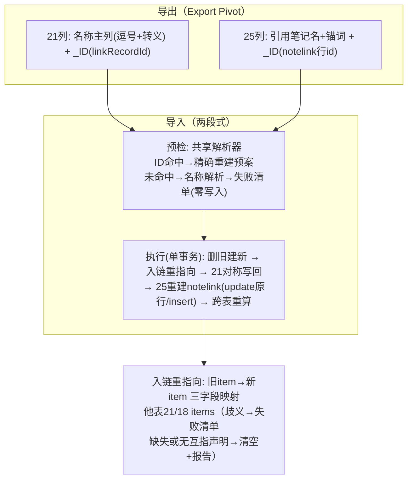

# feat: 链接列导入导出双向适配（双向链接/语义链接）

## Summary

让双向链接（type=21）与语义链接（type=25）两种列在 Excel 导出/导入间无损往返：导出为"可读名称主列 + `_ID` 机器锚点副列"，导入优先按 ID 精确重建、名称解析作回退；语义链接导入从零建立（重建 NoteNotelink 行）；替换式导入后其他表的入链按 ID 映射精准重指向，取代现状的整列清空。

---

## Problem Frame

现状三条断层（见 origin）：导出 `_ID` 副列被导入忽略、两边约定不咬合；语义链接列被导入硬排除（"语义关联列不参与导入"）；替换导入对其他表入链整列清空（连显示值一并抹除）。两位审查者以库内证据确认语义链接方向为"引用笔记 → 本表单元格"，此前文档曾写反。2026-10-10 两项裁决：ID 优先+名称回退；重指向歧义进失败清单、仅目标确不存在才清空。

---

## Requirements

**导出（origin R1–R4）**

- R1. 21 列导出名称主列（目标记录名，多值逗号连接，含分隔符名称引号转义）+ `列名_ID` 副列；表头沿用现有双列形态，导出/导入两侧一致。
- R2. 25 列导出名称主列：每条链接写"引用笔记名（锚词）"（锚词为空省略括号），多值逗号连接、同款转义；`列名_ID` 副列写 NoteNotelink 行 id（与名称条目顺序一一对应）。
- R3. `_ID` 副列保留且导入侧开始消费（优先按 ID 精确重建；ID 与名称不一致以 ID 为准）。
- R4. 悬空引用（目标记录/表/notelink 行已不存在）导出为空单元格，不报错。

**导入（origin R5–R10）**

- R5. 21 列导入：`列名_ID` 命中即按 ID 精确重建 linkRecordId/linkColumnId/linkItemId 并复用现有对称写回；无 ID 或 ID 未命中时名称回退解析。
- R6. 25 列导入：`列名_ID` 命中即按行 id 恢复该 notelink 行核心字段；回退路径按笔记名解析来源笔记，以本表新行坐标重建行（linkDwTableId=本表、linkNoteId=本表归属笔记规范值、blockId 置 null 接受锚点降级、contextText=锚词）。
- R7. 名称解析容错：整串优先→精确→归一化比较（去首尾空格/全半角/大小写）→唯一前缀（≥2 字符）；歧义即失败。
- R8. 解析失败进结构化失败清单（单元格定位+原因+容错命中说明），该次导入零写入；21/25 强失败为新设行为（18 列弹框补选维持不变）。
- R9. 多值单元格逐条目解析，任一失败并入清单（语义链接多值为现存数据形态）。
- R10. agent 路径与界面路径一致返回失败清单；18 列缺参改走界面的边界不变。

**入链重指向（origin R11–R13，含 2026-10-10 裁决）**

- R11. 替换导入重建记录后，他表指向本表旧记录的 21 入链与 18 入链按"旧 item→新 item"映射同步重写 linkRecordId、linkItemId、value 三字段；映射未覆盖者名称回退。notelink 目标行不在此列——由 25 列重建的行内更新机制覆盖（R6/U4）。
- R12. 重指向处置区分三类（2026-10-10 规划裁决）：名称回退歧义进失败清单（零写入）；目标记录确已不存在→单元格级全清（链接字段+value 显示值）并报告；21 配对列中导入计划已无对侧互指声明的旧条目→按条目级清空并报告（维持配对列互指一致性；18 列单向、无条件重指向）。
- R13. 重指向取代现状整列清空（kept 配对列与他表 18 列一并）；被删列的级联删除语义不变。

---

## Key Technical Decisions

- **双轨制（ID 优先、名称回退）**：裁决结果。`_ID` 副列保留并开始消费；ID 与名称不一致时以 ID 为准。重名/空名/基列问题随之消解。
- **共享名称解析组件**：整串优先、转义还原、归一化、唯一前缀、歧义判定提取为独立 resolver，21/25/重指向三处复用——扩展自导入服务既有 candidateNames 整串优先逻辑（`NoteDwtableExcelImportServiceImpl` 现有实现），不另造轮子。
- **分隔符与转义**：沿用现有逗号约定；名称含逗号/引号时导出侧 CSV 风格引号转义（包裹+内层引号翻倍），导入先还原再拆分。整串优先兜底未转义的既有数据。
- **25 列条目语法**：条目内以全角括号定界——导出写"引用笔记名（锚词）"，锚词为空省略括号；导入在名称解析前按首个"（"剥离锚词（括号后缀不参与笔记名匹配），锚词写入 contextText。此语法同时约束导出（U1）、解析剥离（U2）、重建（U4）三处。
- **25 列 `_ID` 载体**：notelink 行 id（与名称条目一一对应），使语义链接同样 ID 优先。
- **重指向映射来源**：替换导入的 Excel 首列 record_id（现有导出已携带）+ 重建回填的新自增 id，构成"旧 item→新 item"精确映射；重指向同步重写 linkRecordId、linkItemId、value 三字段（21/18 同口径，value 刷新为新记录名）。现状 (c) 阶段"整列清空"改为"收集-重指向"；21 配对列以导入计划的对侧互指声明为准，无声明的旧条目按条目级清空并报告。重指向在 Java 侧读-改-写（拆串→映射→去重→join），不走集合式 SQL 替换（防逗号串子串误替换）；Mapper 仅提供按主键单行 update。
- **事务时机**：重指向在 executeImport 单事务内执行——全删前捕获旧引用集合，建新落库（回填新 id）后、**21 对称写回之前**执行重指向（借对称写回既有的 FOR UPDATE 读取与 CSV 去重合并旧 id→新 id，避免配对列重复条目），其后对称写回、25 列重建、跨表重算；失败清单在预检阶段即完成解析判定。
- **不变性守护**：18 列 `列名_文本` 机制、SQL 导入排除集（18/21/25）、agent 既有边界三者回归不动，测试逐项锁定。

---

## High-Level Technical Design

---

## Implementation Units

### U1. 导出侧：链接列双轨格式与语义修正

- **Goal:** 21/25 列导出为可读名称主列+`_ID` 副列，语义链接文本携带引用笔记名与锚词，悬空写空，名称转义。
- **Requirements:** R1–R4
- **Dependencies:** 无（可与 U2 并行）
- **Files:** `ruoyi-system/src/main/java/com/ruoyi/system/service/impl/NoteDwtableExportPivotServiceImpl.java`；`ruoyi-system/src/test/java/com/ruoyi/system/service/impl/NoteDwtableExportPivotServiceImplTest.java`（不存在则新建）
- **Approach:** 在现有 18/21 双列分支上改造：21 名称列写入转义后的记录名多值串（现状已有记录名 join，补转义）；25 文本列由"笔记标题 join"改为"笔记名+锚词"条目串（方向：引用笔记为源），`_ID` 列由 linkNoteId 改为 notelink 行 id 串；悬空引用分支写空。
- **Patterns to follow:** 现有 `resolveSemanticLinkColumn` 的 Set 收集与 join（多值聚合）；`item.getLinkRecordId().split(",")` 的多值拆分约定。
- **Test scenarios:**
  - 21 列单目标：单元格=记录名、`_ID`=该记录 id（Covers F1 场景的导出半程）。
  - 21 列多目标：逗号连接顺序与 id 顺序一致。
  - 记录名含逗号：导出串被引号包裹、内层引号翻倍。
  - 25 列多行 notelink：条目数与 `_ID` 串的 id 数一致、顺序对应。
  - 25 列 linkNoteId 为 null 的历史行：文本仍产出（笔记名经归属兜底）、`_ID` 为行 id。
  - 悬空引用（目标记录已删/表已删）：名称与 `_ID` 均为空。
  - 回归：18 列导出输出与现状逐字节一致。
- **Verification:** 导出既有含 21/25 列的表，Excel 中名称可读、`_ID` 可机读；18 列回归通过。

### U2. 共享名称解析组件

- **Goal:** 提取三处共用的名称解析器：转义还原→整串优先→归一化→唯一前缀→歧义判定。
- **Requirements:** R7
- **Dependencies:** 无
- **Files:** `ruoyi-system/src/main/java/com/ruoyi/system/service/impl/LinkNameResolver.java`（新建）；`ruoyi-system/src/test/java/com/ruoyi/system/service/impl/LinkNameResolverTest.java`
- **Approach:** 以现有 candidateNames 整串优先逻辑（`NoteDwtableExcelImportServiceImpl` 内）为骨架抽出；输入为单元格文本+候选名列表，输出为逐条目解析结果（命中/歧义/未命中+容错命中说明）。归一化：trim、全角半角归一、大小写不敏感。
- **Patterns to follow:** 现有整串命中即返回整串的逗号处理注释；18 列现状的"同名取 sort 最小"不进入本组件（那是 18 专属，保持内联）。
- **Test scenarios:**
  - 精确命中单候选；多值逐条目全命中。
  - 含逗号名称被引号包裹：先还原转义，整串命中。
  - 未转义的含逗号名称（既有数据形态）：整串优先命中。
  - 歧义（两个候选同前缀唯一化前）：返回歧义而非任选。
  - 唯一前缀命中（≥2 字符）；1 字符前缀不触发容错、按未命中。
  - 全角/半角、大小写、首尾空格差异归一后命中。
  - 空串条目：跳过不计失败（对应"无链接"）。
- **Verification:** 组件单测全绿；U3/U4/U5 引用同一组件而非各自实现。

### U3. 导入侧：21 列 ID 优先重建

- **Goal:** `列名_ID` 从忽略改为消费，ID 命中精确重建并对称写回；未命中走名称回退。
- **Requirements:** R5, R7–R9；覆盖 AE1（双向链接往返）、AE4（失败报告）
- **Dependencies:** U2
- **Files:** `ruoyi-system/src/main/java/com/ruoyi/system/service/impl/ExcelColumnMatcher.java`；`ruoyi-system/src/main/java/com/ruoyi/system/service/impl/NoteDwtableExcelImportServiceImpl.java`；`ruoyi-system/src/test/java/com/ruoyi/system/service/impl/NoteDwtableExcelImportServiceImplTest.java`
- **Approach:** matcher 中 `列名_ID` 命中 21 列的分支由"忽略"改为登记 ID 列；名称主列识别同时接受列原名与 `列名_文本`（round-trip 与外部手写两种来源）；execute 阶段 ID 命中→直接重建 link 字段并调用现有 `executeSymmetricWrite`；ID 缺失/未命中→LinkNameResolver 回退；歧义/未命中→进失败清单（预检阶段判定，零写入）。
- **Patterns to follow:** 现有 TEXT_SUFFIX 后缀剥离与缺参记录选择器（18 专属，保持）；`executeSymmetricWrite` 复用不改其配对语义。
- **Test scenarios:**
  - Covers AE1. 导出文件不改再导入：链接恢复、配对列对称引用存在。
  - `_ID` 命中但名称被外部改写：以 ID 为准重建，名称不产生失败。
  - `_ID` 未命中（目标已删）且名称回退命中唯一：按名称重建。
  - 名称回退歧义：预检失败清单含定位与原因，整表零写入。
  - 多值部分命中：整表零写入（R9）。
  - 空 `_ID`+空名称：无链接，不失败。
  - 回归（18 列）：`列名_文本` 缺参仍走记录选择器、同名取 sort 最小——18 行为逐项断言不变。
- **Verification:** 往返集成用例（导出→导入）链接零损失；18 列回归用例全绿。

### U4. 导入侧：25 列从零建立

- **Goal:** 25 列移出排除集，预检解析、执行重建 NoteNotelink 行（ID 优先）。
- **Requirements:** R2, R6–R9；覆盖 AE2（语义链接往返）
- **Dependencies:** U2, U3（失败清单结构）
- **Files:** `ExcelColumnMatcher.java`；`NoteDwtableExcelImportServiceImpl.java`；`ruoyi-system/src/main/resources/mapper/system/NoteNotelinkMapper.xml`（清旧行复用 deleteNoteNotelinkByColumnId；新增按主键 update 行内坐标）；`ruoyi-system/src/main/java/com/ruoyi/system/mapper/NoteNotelinkMapper.java`；对应测试文件
- **Approach:** EXCLUDED_TYPES 移除 25（"语义关联列不参与导入"注释随之删除）；matcher 识别 25 的名称主列与 `_ID` 列；预检按 `_ID` 或笔记名（LinkNameResolver 对全部笔记名）解析并出失败清单；执行阶段：重建前按列调用既有 deleteNoteNotelinkByColumnId 清空旧行（旧行核心字段已在预检按 `_ID` 捕获）；`_ID` 命中→update 原行（保留行 id 与 blockId——笔记正文锚点 data-link-id 不断链——恢复 noteId/contextText/itemValue、刷新 linkRecordId/linkItemId 为本表新坐标），否则按解析结果 insert 新行（linkDwTableId=本表、linkColumnId/linkItemId=本表新坐标、linkNoteId=本表归属笔记规范值、blockId=null 降级、contextText=锚词）。
- **Patterns to follow:** `selectNoteNotelinkByCell` 的 (linkColumnId, linkItemId) 定位约定；linkNoteId 规范值=NoteDwtable.noteId（COALESCE 兜底规则仅用于查询，不进新建行）。
- **Test scenarios:**
  - Covers AE2. 导出再导入：行重建、目标坐标指向本表新记录、URL 跳转参数完整。
  - `_ID` 命中：noteId/blockId/contextText/itemValue 按原行恢复（blockId 为源笔记侧锚点、不受本表重建影响；锚点降级仅适用于名称回退路径）。
  - 重导后 notelink 行 id 不变：源笔记锚点 data-link-id 不断链，坐标指向新 item。
  - 笔记名回退命中唯一笔记：新建行、linkNoteId 为规范值。
  - 笔记重名歧义：失败清单零写入。
  - 多锚点单元格（多行 notelink）：逐条目全命中才通过。
  - 悬空导出（空名称+空 `_ID`）再导入：不建行、不失败。
  - 回归：26 列等其余排除类型行为不变。
- **Verification:** 往返用例 notelink 行数与关键字段一致；悬空场景静默为空。

### U5. 入链重指向（取代整列清空）

- **Goal:** 替换导入重建记录后，他表 21/18 入链按"旧 item→新 item"映射三字段精准更新；取代现状整列清空。
- **Requirements:** R11–R13；覆盖 AE3（入链重指向）
- **Dependencies:** U2（名称回退），与 U3/U4 同事务框架
- **Files:** `NoteDwtableExcelImportServiceImpl.java`（替换阶段 (c) 重写）；`ruoyi-system/src/main/resources/mapper/system/NoteDwtableItemMapper.xml`（仅提供按主键单行 update；`clearLinkFieldsByColumnId` 保留但仅用于列级联）；`ruoyi-system/src/main/java/com/ruoyi/system/mapper/NoteDwtableItemMapper.java`；`NoteDwtableExcelImportServiceImplTest.java`
- **Approach:** 全删前捕获旧引用集合（他表 items 中 linkRecordId 指向本表旧记录的单元格——按 linkRecordId 全量反查，不复用列扫描以防空配漏捕）；建新落库（回填新 id）后、21 对称写回之前，以 Excel record_id 首列+回填新 id 构造"旧 item→新 item"映射，Java 侧读-改-写（拆串→映射→去重→join）三字段重写 linkRecordId/linkItemId/value（value=新记录名）；21 配对列以导入计划的对侧互指声明为前提，无声明的旧条目按条目级清空并报告；未覆盖→名称回退；歧义→失败清单零写入，缺失→单元格级全清+结果报告。现状 (c) 对 kept 配对列与他表 18 列的整列清空移除；被删列级联删除保留。
- **Patterns to follow:** 现有替换阶段的事务边界与 (i) 跨表重算的先后关系；`clearLinkFieldsByColumnId` 的"清链接字段+value、保留 linkColumnId"语义在单元格级清空中复刻。
- **Test scenarios:**
  - Covers AE3. 重导后他表 21 入链三字段重写（linkRecordId/linkItemId/value）；18 入链 value 同步刷新为新记录名。
  - Excel 删除了被引用行：该入链单元格级全清（含 value）、结果报告含条目。
  - Excel 删除正向链接（目标行仍存活）：配对列背链条目级清空+报告，互指一致性保持。
  - 名称回退歧义：整表零写入、清单含定位。
  - kept 列配对列不再被整列清空（旧数据保留断言）。
  - 被删列的配对列级联删除仍生效（R13 后半）。
  - 重指向先于对称写回与跨表重算；不改一字往返后配对列无重复条目。
  - 回归：无入链场景的替换导入输出与现状一致。
- **Verification:** 重导含入链的表，他表数据完好且链接指向新记录；旧"陪葬"用例改判为保留。

### U6. 失败清单呈现与路径一致性

- **Goal:** 预检弹框与 agent 结果呈现链接列失败清单；三条不变性回归收口。
- **Requirements:** R8, R10；覆盖 AE4 呈现半程
- **Dependencies:** U3, U4（清单结构）
- **Files:** `ruoyi-system/src/main/java/com/ruoyi/system/domain/dto/ExcelImportPrecheckResult.java`；`ruoyi-system/src/main/java/com/ruoyi/system/service/impl/NoteDwtableExcelImportServiceImpl.java`（agent 入口的链接失败清单结果映射）；`ruoyi-admin/src/test/java/com/ruoyi/web/controller/system/NoteDwtableControllerExcelImportTest.java`；`ruoyi-system/src/test/java/com/ruoyi/system/service/impl/NoteDwtableExcelImportAgentTest.java`；`notepad/src/components/baseTable/ImportPrecheckModal.vue`；`notepad/src/api/import.ts`
- **Approach:** 失败清单条目复用现有缺参清单结构扩展链接失败类型（定位/原因/容错命中说明）；ReplaceImpact.clearedLinkColumns 语义随重指向改造迁移——预检输出改为"将重指向的列/单元格数 + 将单元格级清空并报告的条目"，弹框文案与 DTO 同步调整；弹框在既有缺参列表区新增链接失败分组，仍走"确认导入"前零写入门禁；agent 结果映射同一 DTO。前端仅呈现，不新增交互。
- **Patterns to follow:** 现有缺参弹框分组与 `{ immediate: true }` watch 约定（防首挂死锁回归）。
- **Test scenarios:**
  - 含链接失败+缺参的混合预检：两类分组并存、零写入。
  - agent 导入含链接失败：结构化清单返回、无半写入。
  - 回归：SQL 导入（18/21/25 仍排除、link 字段不搬运）用例不变。
  - 回归：agent 18 列缺参仍提示改走界面。
  - 前端 build 通过 + 弹框在删除-重建场景正常显示。
- **Verification:** 手测一次含错名链接的导入：弹框清单可见、修正后导入成功。

---

## Scope Boundaries

- SQL 导入链路不动（18/21/25 维持排除）。
- 18 列用户可见行为不变（`列名_文本`、选择器、同名取 sort 最小）。
- 容错命中项进预检清单供确认、存量悬空 notelink 体检工具：不做。

### Deferred to Follow-Up Work

- 容错命中（唯一前缀等）当前静默通过——审查建议预检同时列出"容错命中"条目供确认，留待后续增强。
- 生产库既有悬空 notelink 行（指向已删表/列）的批量体检与清理工具。
- 21/25（强失败）与 18（预选）歧义策略的统一化。

---

## Risks & Dependencies

- **共享匹配代码回归面**：18 与 21 共用机制但歧义语义分叉（预选 vs 失败），U3/U6 回归用例是主要防线。
- **重指向与删旧建新的时序**：必须全删前捕获旧引用，U5 的时序用例锁定。
- **25 列历史 linkNoteId=null**：仅查询路径走 COALESCE，新建行不受影响；AE2 断言规范值。
- **替换导入事务变大**：重指向并入既有单事务，无新事务边界。

---

## Acceptance Examples

- AE1. 21 列往返（Covers R1, R5, R9）— 导出表 A（链接指向表 B"满攻"）不改再导入：链接恢复、B 配对列对称引用。
- AE2. 25 列往返（Covers R2, R6）— 导出再导入：notelink 行重建、目标坐标指向本表新记录、跳转 URL 正常。
- AE3. 入链重指向（Covers R11, R12）— 重导表 A：表 B 入链指向新 id；"满攻"被删则该入链清空+报告。
- AE4. 失败报告（Covers R7, R8）— 错名导入：弹框列出定位与原因，整表零写入。

---

## System-Wide Impact

- 预检 DTO 消费方（界面弹框、agent 结果、控制器测试）同步演进，结构向后兼容（新增类型不改旧字段）。
- 替换导入对他表的破坏半径从"整列清空"降为"单元格级清空+精准重指向"，属行为修复。

---

## Sources & Research

- `docs/brainstorms/2026-10-09-link-column-import-export-requirements.md` — origin 需求（含两轮校验事实与两项裁决）
- `CONCEPTS.md` — Double Link/Semantic Link/back_field_id/Relation Text Matching/Link Re-pointing 词条
- `ruoyi-system/src/main/java/com/ruoyi/system/service/impl/NoteDwtableExcelImportServiceImpl.java` — 现有 TEXT_SUFFIX 匹配、executeSymmetricWrite、替换阶段、candidateNames 整串优先
- `ruoyi-system/src/main/java/com/ruoyi/system/service/impl/ExcelColumnMatcher.java` — EXCLUDED_TYPES（25 在其中）、`列名_ID` 忽略分支
- `ruoyi-system/src/main/java/com/ruoyi/system/service/impl/NoteDwtableExportPivotServiceImpl.java` — 现有 18/21/25 双列导出
- `ruoyi-system/src/main/resources/mapper/system/NoteDwtableItemMapper.xml`、`NoteNotelinkMapper.xml` — link 字段存储与清理 SQL
- `docs/solutions/database-issues/notelink-linknoteid-null-recovery.md` — linkNoteId 历史兜底
