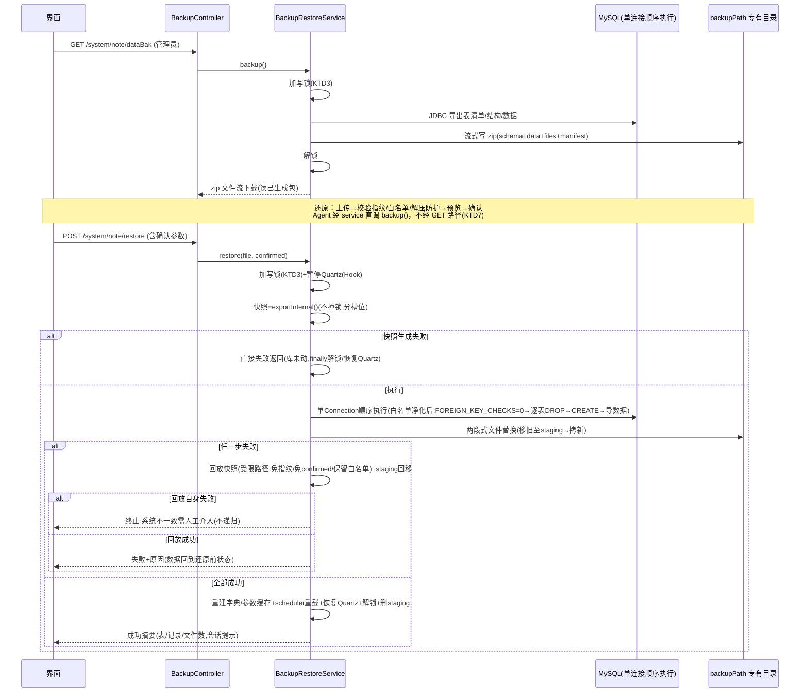

# feat: 整机迁移备份与一键还原

## Summary

应用内整机迁移备份：一键将全库数据 + 用户文件目录（upload/avatar/import）打包为带清单的 zip 下载；上传备份包经校验-预览-确认后全量替换还原（库结构+数据+文件），还原前自动快照、失败回退。挂载现有"数据备份"按钮（当前 404 空壳），同步提供 agent 命令。

## Problem Frame

见 origin（数据保护断层：服务器 cron 只备 DB 不含文件；界面按钮 404；文件散落 profile 目录树单备任一无法完整迁移）。

## Requirements

origin R1-R10 全量承载，关键约束复述：
- 备份包 = 全库表结构+数据（JDBC 逻辑导出）+ upload/avatar/import 目录 + 清单（包格式版本、表结构指纹、生成时间、表清单、文件统计）；download 不纳入（R2/R3）
- 还原 = 全量替换（表按包内结构重建+数据导入，目录替换）；schema 指纹不一致拒绝；sys_user 变更明细告警；解压路径穿越/体量防护（R5/R6）
- 还原前快照（保留最近 1 份）、失败回退、还原后重建字典/参数缓存、会话按 userId 匹配决定免重登或提示重登（R7/R8）
- 备份/还原期间写锁；管理员（userId==1）鉴权 + @Log；落盘专有目录不经 `/profile/**`（R9/R10）
- 还原上传通道：调高 multipart 上限 + nginx client_max_body_size 配套（Dependencies 假设）
- agent 备份命令与界面同一后端能力，结果返回引导界面下载（R4；agent 不触发还原见 KTD7）

## Key Technical Decisions

- KTD1 **JDBC 逻辑导出/导入**：`DatabaseMetaData.getTables(connection.getCatalog(), null, "%", new String[]{"TABLE"})` 取表清单（catalog 限定连接库 + 类型 TABLE 天然排除视图/系统库；追加 `QRTZ_%` 前缀排除——Quartz 表集合因环境初始化差异不纳入备份，见 Risks），`SHOW CREATE TABLE` 导结构、`SELECT *` 导数据为 INSERT 语句文本；导入顺序执行（会话级 `SET FOREIGN_KEY_CHECKS=0`）。零外部进程依赖。
- KTD2 **表结构指纹 + SQL 语句白名单（词法级契约）**：清单内嵌指纹 = 全部表名+列名+列类型排序哈希（两侧同算法比对，不一致拒绝）；指纹防"版本错配"不防"恶意构造"——还原执行前对 schema/data/*.sql 做**词法级 token 扫描状态机**白名单净化（单引号字符串/反引号标识符/`#` 注释/`--` 行注释/`/*!..*/` 可执行注释/双引号串/反斜杠转义——MySQL 会执行 `/*!..*/` 内内容，朴素解析器当注释跳过即为逃逸面；**fail-closed**：任何无法分类的 token 整体拒绝还原），禁止字符级分号切分；放行形态严格限定：`DROP TABLE \`表\``、`CREATE TABLE \`表\`(...)`（纯结构定义，拒 CREATE...SELECT）、`INSERT INTO \`表\`(\`列\`...) VALUES(纯字面量/NULL/数值)`（**拒 INSERT...SELECT、函数调用值、子查询、表达式**——INSERT...SELECT 可从 mysql.user 外带数据、函数值可 LOAD_FILE/SLEEP）；放行语句以**解析产物重新渲染后执行**（不透传包内原文）。备份包无签名，白名单+sys_user 告警是本期接受的供应链残余（见 Risks）。
- KTD3 **JVM 进程内写锁**：`AtomicBoolean` 全局标志（备份/还原共用，触发级互斥），消费者侧在既有写操作入口植入标志检查（导入两个服务、agent 写操作、`removeAllData` 所在服务——文件清单见 U1）；**backup() 拆为"入口检查薄壳 + exportInternal()（不检锁）"**——restore 内部生成快照走 exportInternal()，避免撞自身置位的写锁。单实例部署前提下足够（进 Risks：多实例需分布式锁）。
- KTD4 **落盘专有目录**：备份包与快照写 `ruoyi.profile` 之外的新配置项 `ruoyi.backupPath`（默认 `/home/ruoyi/backup`，Windows dev 默认 `D:/ruoyi/backup`，两端 basename 一致）——不在 `/profile/**` 静态映射内，取回仅经鉴权下载端点；快照与常规备份**分槽位**各保留最近 1 份（防互顶恢复点）；启动时清理 >24h 临时目录（文件 swap 的 staging 目录排除在清理范围外，见 KTD6）。
- KTD5 **下载/上传通道**：备份下载复用 `CommonController` 文件流模式（写 zip 落盘 → 流式响应，响应头追加 `Cache-Control: no-store`——包含密码哈希+PII 不允许中间缓存）；还原上传 multipart 上限调至 512MB（application.yml 生产/开发同步），nginx 段 `client_max_body_size 512m` + restore 路由 `limit_req` 限速进部署手册（匿名可达 512MB 请求体是资源耗尽放大器，限速为必选项）。不做分片上传（≤500MB 同步边界）。
- KTD6 **还原失败恢复：快照回放（受限内部路径），非事务回滚**：MySQL DDL（DROP/CREATE）触发隐式提交，"单事务回滚"机制性不可行——导入语句在单 Connection 顺序执行（会话级 FOREIGN_KEY_CHECKS=0），**一致性由失败后回放还原前快照保证**，不依赖 DB 事务。回放是**受限内部路径**而非"再执行一次 restore"：跳过指纹校验（现库已知半还原、指纹必不匹配）、跳过快照生成（不得用半损坏库顶替唯一恢复点）、免 confirmed、保留解压防护与 SQL 白名单（快照自产可信、过白名单零成本）；**终止条件：回放自身失败不递归**——立即终止并报"系统处于不一致状态，请人工介入或重启自愈"。失败区分两段：快照生成阶段失败 → 直接失败返回（库未动，无需回放，finally 解锁/恢复 Quartz）；执行阶段失败 → 回放快照 + staging 回移。文件侧"移旧至 staging → 拷新 → 成功删 staging"两段式；未完成 swap 检测+回移提为**可即时调用的内部方法**（非仅启动钩子）——运行期回移失败立即重试+告警+标记三目录不可用（拒绝后续文件写），启动时同样检测兜底；staging 排除于 >24h 清理。还原前暂停 Quartz 调度器，成功后 `scheduler.clear()` + 从新 sys_job 重载（重载失败走失败回放分支——恶意包植入无效 cron 会让 CronScheduleBuilder 抛异常）；缓存重建（字典/参数）同步执行。**跨模块编排**：Scheduler/SysJobServiceImpl 在 ruoyi-quartz 模块而 BackupRestoreServiceImpl 在 ruoyi-system（pom 无依赖）——ruoyi-system 定义回调接口 `RestoreSchedulerHook`（pause/resume/reload），ruoyi-quartz 实现并注入（接口反转，无循环依赖）。
- KTD7 **agent 备份命令**：新增 `@AgentOperation`（按现有 agent 命名惯例，**声明非空 permissionKey**——空键时 agent 权限闸门放行，任一登录用户可触发全库导出；映射现有管理员级权限键）复用同一 service，服务入口加 userId==1 判定兜底；agent 结果返回"备份完成+文件名+引导界面下载"（agent 无文件下载通道）。agent 不触发还原（预览+二次确认无法映射 agent 交互）。

## High-Level Technical Design

备份包结构（zip 内布局）：

```text
manifest.json          # {packageVersion, schemaFingerprint, createdAt, tables:[{name,rows}], fileStats}
schema/<table>.sql     # 每表一个文件：DROP+CREATE 语句（SHOW CREATE TABLE 原文）
data/<table>.sql       # 每表一个文件：INSERT 批量语句
files/upload/**        # upload 目录原样
files/avatar/**        # avatar 目录原样
files/import/**        # import 目录原样
```

备份时序（F1）与还原时序（F2）：



## Implementation Units

### U1. 备份核心服务：JDBC 导出 + zip 打包 + 写锁

**Goal**：`BackupRestoreService.backup()` 产出完整备份包并落盘 backupPath（分槽位），含 manifest；写锁机制建立并在既有写操作入口植入消费者检查。
**Requirements**：R1, R2, R3（备份侧）, R9（备份侧写锁+消费者检查）, R10（落盘专有目录）。
**Files**：
- `ruoyi-system/src/main/java/com/ruoyi/system/service/impl/BackupRestoreServiceImpl.java`（新建）
- `ruoyi-system/src/main/java/com/ruoyi/system/service/IBackupRestoreService.java`（新建）
- `ruoyi-common/.../config/RuoYiConfig.java`（加 backupPath 配置项，对齐 profile 字段模式）
- `ruoyi-admin/src/main/resources/application.yml` / `application-prod.yml`（backupPath 值 + multipart 上限调 512MB）
- 写锁消费者植入点：`NoteDwtableExcelImportServiceImpl.java`、`NoteDwtableImportServiceImpl.java`（SQL 导入）、`NoteNoteServiceImpl.java`（removeAllData）等含写操作的服务入口（实施时以 `@AgentOperation` 写操作 grep 定位补全）
- `ruoyi-system/src/test/java/com/ruoyi/system/service/impl/BackupRestoreServiceImplTest.java`（新建）
**Approach**：`DatabaseMetaData.getTables(connection.getCatalog(), null, "%", new String[]{"TABLE"})` 取表清单（catalog 限定 + 类型过滤 + `QRTZ_%` 排除，KTD1）；`SHOW CREATE TABLE` 取结构原文；数据导出为**逐行 INSERT**（禁多 VALUES 单语句——为 U2 白名单解析器提供可枚举的确定形态），SELECT 采用 **LIMIT/OFFSET 分页批查（5000 行/批）**控制堆内存上界（Connector/J 默认全量缓冲结果集）；转义引号/处理 null/二进制列 hex 编码；**zip 流式落盘**：`ZipOutputStream` 直接包裹 `FileOutputStream` 逐条目写 backupPath 文件（借鉴 NoteDwtableExportPackager 的 entry 命名/manifest 组织，**不借鉴其内存 byte[] 返回形态**——190MB+ 规模堆内构建有 OOM 风险）；manifest 含 schema 指纹（表名+列名+类型排序 SHA-256）；写锁 KTD3（`backup()` 入口检查薄壳 + `exportInternal()` 不检锁——供 restore 快照复用；消费者检查植入——各写方法入口嵌标志位检查，拒绝时返回"系统备份/还原进行中，请稍后"）；完成后按分槽位保留最近 1 份、清理旧包。
**Patterns to follow**：`NoteDwtableExportPivotServiceImpl` 的导出结构；`RuoYiConfig` 的 profile 配置项模式；`CommonController` 的分块文件流。
**Test scenarios**：
1. 备份产出 zip：manifest 字段齐全（包版本/指纹/时间/表清单含行数/文件统计），schema/data 每表一文件，files 三目录原样入包；**QRTZ_ 表不在包内**
2. 数据含特殊值：字符串含引号/null/中文/二进制列——导出再导入后逐值一致（转义正确性）
3. 指纹稳定性：同一库两次备份指纹相同；增删列后指纹变化
4. 空表导出：结构文件有、数据文件空，manifest 行数 0
5. download 目录与 backupPath 自身不入包（防递归）
6. 写锁互斥：备份进行中再次触发备份被拒绝
7. 消费者检查：写锁持有期间调用导入/removeAllData 被拒绝并返回提示文案；锁释放后放行
**Verification**：单测绿；手动触发一次备份得到可解压检验的 zip。

### U2. 还原核心服务：校验 + 全量替换 + 快照回放

**Goal**：`restore()` 完整实现 F2 时序——指纹校验、SQL 白名单净化、解压防护、快照、库重建、两段式文件替换、快照回放恢复、缓存/调度器重建（KTD2/KTD6）。
**Requirements**：R5, R6, R7, R8（服务侧）, R9（还原侧写锁）。
**Files**：
- `BackupRestoreServiceImpl.java` / `IBackupRestoreService.java`（续 U1）
- `ruoyi-quartz` 模块：`RestoreSchedulerHook` 实现类（pause/resume/reload，KTD6 跨模块接口反转；接口定义在 ruoyi-system）
- `BackupRestoreServiceImplTest.java`（续）
**Approach**：校验阶段（不写库）：解 zip 到临时目录（`ZipInputStream` 流式逐条目——防路径穿越 + 总解压大小/条目数上限；**请求结束 try-finally 删除本次解压临时目录**，启动清理仅兜底）→ 读 manifest → 指纹与现库比对不一致拒绝 → **SQL 语句白名单净化**（KTD2 词法级状态机：fail-closed、覆盖 `#`/`/*!..*/`/双引号/反斜杠转义；INSERT 仅限 `INSERT INTO 表(列) VALUES(纯字面量/NULL/数值)`——拒 INSERT...SELECT/函数值/子查询；**解析产物重新渲染后执行**，不透传原文）→ 统计预览数据（表数/记录数/文件数/sys_user 账号数与凭据变更检测——**差异明细仅输出账号数与"凭据已变更"布尔，password 列值不进任何响应与日志**）。执行阶段（需 confirmed 参数，**confirmed 请求对本次上传文件重跑全部校验**——不跨请求信任预览结果）：加锁+暂停 Quartz（经 RestoreSchedulerHook）→ 快照（复用 exportInternal()，分槽位；**快照生成失败 → 直接失败返回，库未动不回放**）→ 单 Connection 顺序执行净化后 SQL（DDL 隐式提交，一致性靠快照回放）→ 文件两段式替换（移旧至 staging → 拷新 → 成功删 staging；未完成 swap 检测+回移为可即时调用内部方法，运行期回移失败重试+告警+标记三目录不可用；启动时检测兜底）→ 执行阶段任一步失败：**回放快照（受限内部路径：跳过指纹/跳过快照生成/免 confirmed/保留白名单与解压防护；回放失败不递归，终止报"系统处于不一致状态，请人工介入"）+ staging 回移** → 成功：字典/参数缓存重建 + scheduler.clear() 并从新 sys_job 重载（重载失败走失败回放分支）+ 会话判定（包内 sys_user 含当前 userId → 免重登，否则标记需重登）。try-finally 保证锁释放/Quartz 恢复。
**Execution note**：先写"还原中途失败回放到一致状态"的特征测试再写实现（回放正确性是本单元最高风险面）。
**Test scenarios**：
1. Covers AE1. 正常还原：模拟库 A 备份 → 篡改库数据 → 还原 → 全表逐值回到备份时点（含 note_note/note_dwtable_item 关键表）
2. Covers AE1. 全新环境还原：目标 profile 三目录均不存在 → 目录被创建、逐文件与包一致（origin AE1 的字面旗舰场景）
3. Covers AE2. 中途失败回放：导入执行到一半抛异常（如 mock 第 N 张表失败）→ **快照回放后**全表与还原前一致、文件回移完成——库与文件均回到还原前状态（不是依赖 DB 事务回滚）
4. 指纹拒绝：包内指纹 ≠ 现库 → 拒绝且零写入
5. SQL 白名单（词法级）：包内 data 混入 `CREATE USER`/`GRANT`/`INTO OUTFILE`/多语句/`INSERT...SELECT`/函数值（LOAD_FILE/SLEEP）/`#` 与 `/*!..*/` 混淆/字符串字面量内 `;` → 整体拒绝零写入；合法语句（表清单内 DROP/CREATE/逐行字面量 INSERT）放行且以重渲染形态执行
6. 解压防护：条目名含 `../` 的包 → 拒绝；条目数/总大小超限 → 拒绝；均在任何库写入前发生
7. 预览与告警：sys_user 凭据/账号数差异出现在预览结果（仅计数与布尔，无 password 值）；无差异时不出现
8. 快照：还原前快照生成（走 exportInternal 不撞写锁）且内容=还原前状态；与常规备份分槽位互不顶替
9. Covers AE3. 会话判定：包内含当前 userId → 免重登标记；不含 → 需重登标记
10. 缓存与调度器重建：还原后字典/参数缓存刷新被调用 + scheduler.clear() 与重载被调用（InOrder，经 RestoreSchedulerHook）
11. Quartz 暂停/恢复与锁清理：还原期间 paused、失败路径 finally 恢复 Quartz + 释放锁；启动时 staging 残留 → 回移旧目录
12. 快照生成阶段失败：exportInternal 抛异常 → 直接失败返回（无回放、库未动、无文件变动）
13. 回放自身失败：库被部分改写后回放再失败 → 不递归、终止报"系统不一致需人工介入"（不静默吞掉）
14. 回放豁免指纹：库被部分改写后回放不被指纹校验阻断（KTD6 受限路径语义）
15. confirmed 重跑校验：预览用包 A、confirm 上传包 B（含恶意 SQL）→ B 被完整校验拒绝
16. 运行期回移失败：staging 回移 IO 失败 → 重试+告警+三目录标记不可用（后续文件写被拒）
**Verification**：单测绿；覆盖 AE1/AE2/AE3 语义。

### U3. 控制器 + 管理员鉴权 + 界面挂载

**Goal**：`/system/note/dataBak`（GET 下载）与 `/system/note/restore`（POST 上传还原）端点落地，双层鉴权 + @Log；前端补"数据还原"入口，打通备份按钮。
**Requirements**：R1（界面侧）, R5（界面侧）, R8（界面侧）, R10。
**Files**：
- `ruoyi-admin/src/main/java/com/ruoyi/web/controller/system/NoteNoteController.java`（dataBak 按钮调的是 /system/note 前缀，落此最自然）
- `notepad/src/layout/container/components/ActionButtons.vue`（备份按钮接通 + 新增还原入口）
- `notepad/src/api/backup.ts`（新建：下载与上传 API 封装）
- `ruoyi-admin/src/test/java/com/ruoyi/web/controller/system/NoteNoteControllerBackupTest.java`（新建，或并入既有控制器测试）
**Approach**：备份 GET 返回文件流（对齐 CommonController 下载响应头模式 + 追加 `Cache-Control: no-store`）；还原为两步——POST 校验预览返回摘要 JSON，POST（confirmed=true+文件）执行；**鉴权双层**：`@PreAuthorize` 权限注解（沿用 NoteNoteController.java:296 先例）+ `getUserId()==1` 兜底判定——仅控制器层判定时匿名请求实际语义是 401 ServiceException（HTTP 200 body）而非 403，测试断言按此实际语义写；**前置 Servlet Filter**：`/system/**` 下未认证 POST 且 Content-Length 超 1MB 直接拒绝（Spring MVC 在处理器调用前已完成 multipart 解析——@PreAuthorize/@RateLimiter 均晚于 512MB 请求体落盘，Filter 是唯一 pre-body 防线）；@Log 记还原操作（**isSaveResponseData=false**——响应含 sys_user 差异摘要；备份下载同样加 @Log）；还原端点加 @RateLimiter（IP 键——匿名场景 USER 键失效，参数对齐导入 60s/10 次先例；XFF 可伪造由 nginx real_ip 收口）；前端还原弹窗（上传→摘要+sys_user 告警+二次确认→进度/结果提示，遵循 ImportPrecheckModal 的分组与确认门禁交互模式；还原成功结果含摘要与重登提示，承载 R8 界面侧）；部署手册更新：nginx 段 `client_max_body_size 512m` + restore 路由 `limit_req`（1r/s 量级+小 burst）+ `real_ip` 固定 + backupPath 目录权限（700/属主限定运行账户）。
**Test scenarios**：
1. 非 admin（userId≠1）调备份/还原 → 拒绝（按实际机制语义断言：200+错误码或 401 ServiceException）且零副作用
2. admin 调备份 → 200 文件流（Content-Disposition/no-store/长度断言）
3. Covers AE3（界面呈现侧）. 还原两步协议：无 confirmed → 返回预览摘要不写库；confirmed=true → 执行（mock service 验证参数传递）
4. @Log（isSaveResponseData=false）与 @RateLimiter 注解存在性与参数断言
**Verification**：控制器测试绿；前端 build 通过；手测界面两入口。

### U4. agent 备份命令 + 收口回归

**Goal**：`@AgentOperation` 备份命令复用 service（KTD7）；全链路回归与红线验证。
**Requirements**：R4, R10（agent 面管理员鉴权：permissionKey+服务层兜底）；整体回归。
**Files**：
- agent 操作注册所在文件（grep `@AgentOperation` 现有 26 个操作的声明处，新增一个）
- `ruoyi-system/src/test/java/com/ruoyi/system/service/impl/NoteDwtableExcelImportAgentTest.java`（或独立 AgentBackupTest）
- `docs/deploy-aliyun-ecs.md`（nginx 段已在 U3 改，此处复核）
**Approach**：agent 命令声明**非空 permissionKey**（映射现有管理员级权限键，对齐 dwtable.importSql 等破坏性操作先例）+ 服务入口 userId==1 兜底；调 `backup()` 后返回结构化消息（表数/记录数/文件数/包大小/文件名 + "请在界面下载数据备份"引导）；agent 路径触发还原**不做**（预览+二次确认无法映射 agent 交互）；agent 触发受同一写锁约束。
**Test scenarios**：
1. agent 备份命令：返回成功摘要含统计与引导文案；备份期间 agent 导入命令被写锁拒绝（互斥验证）
2. 非 admin 经 agent 触发备份被拒（permissionKey 权限闸门或服务层 userId 判定——验证至少一层拦截）
3. 红线回归：既有 21/25 列导入、removeAllData、Excel 导出全量测试不受影响（跑全量）
**Verification**：全量 `mvn -pl ruoyi-system,ruoyi-admin test` 绿 + notepad `npm run build` 通过。

## Scope Boundaries

- origin 的不做清单全部沿用：应用内定时备份/保留策略/磁盘管理、合并式还原、选择性还原、应用本体分发、agent 文件下载通道改造。
- **Deferred to Follow-Up Work**：`import` 目录孤儿文件清理机制（无清理逻辑导致包虚胖，属部署卫生非本特性）；界面常驻"上次备份时间"提示（评审 FYI，低成本但非本期）。

## Risks & Dependencies

- 单实例 JVM 锁假设（KTD3）——多实例部署需分布式锁，当前单机部署形态不触发；部署形态变化时重估。
- **备份包供应链残余**：包无签名无完整性来源（经个人设备/网盘迁移是既定场景），SQL 白名单挡语句级攻击但不防合法语句的值级篡改（覆写行数据/插入恶意管理员行）——sys_user 变更告警提供事后线索，本期接受此残余（origin R5 已含告警承诺）。
- JDBC 逻辑导出的类型边界（二进制/时间/JSON 列的转义）——U1 场景 2 锁定；如遇罕见类型失败，回退方案为该列 hex 全量编码。
- 512MB multipart 对 Tomcat 的压力——上传落临时文件 + `ZipInputStream` 流式解压，避免堆内存峰值；multipart 上限为全局配置（/common/upload 等通道同享 512MB 上限，已鉴权属滥用面非漏洞）；还原 DROP/重建窗口内并发读会瞬时 500（单管理员场景可接受，还原弹窗文案预期管理）。
- QRTZ_ 表排除（KTD1）——Quartz 表因环境初始化差异（部署手册全新初始化不含 quartz.sql）不纳入备份；还原后调度器经 `scheduler.clear()`+重载与 sys_job 一致。
- 依赖：U2 依赖 U1（快照复用 backup）；U3 依赖 U1/U2；U4 依赖 U3。

## Acceptance Examples

origin AE1-AE3 由 U2 场景 1/2（AE1）、U2 场景 3（AE2）、U2 场景 9（AE3）承载；U3 承载 AE3 的界面呈现侧（还原摘要与重登提示）。见各单元 Test scenarios 的 Covers 标注。
