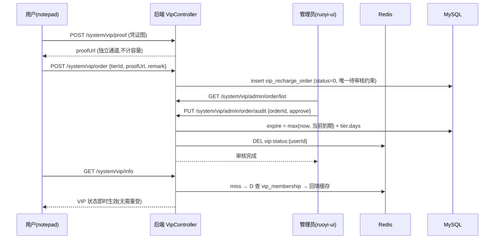

# feat: VIP 会员系统

## Summary

实现单档 VIP 会员体系：`vip_*` 三张业务表 + 上传记录表支撑充值申请→管理员审核→开通的完整闭环；`VipService` 作为唯一鉴权入口，Redis 缓存 VIP 状态，在上传、笔记创建、高级列创建、AI 对话、Agent、回收站保留期、共享创建、个人数据导出八个执行点强制限额（整机备份维持仅管理员——VIP 备份权益以按用户范围的个人数据导出实现）；notepad 用户端 VIP 页 + ruoyi-ui 管理端审核/配置页。限额数值全部走 sys_config 在线可调。

## Problem Frame

系统高价值能力（高级列、AI/Agent、整机备份、回收站）对所有注册用户无差别开放，上传接口无任何按用户的限额（见 origin Problem Frame）。需要不依赖商户支付资质的付费分层：静态收款码 + 凭证人工审核。落地障碍：`note_note` 无任何时间字段且回收站无清理任务（保留期需补基建）；编辑器图片/文件块已在调用 `/common/upload` 但无记录无限额（容量统计需新建上传记录表，存量文件不回填、自上线起算）；`FileUploadUtils` 硬编码 50MB 单文件上限（VIP 512MB 需参数化改造）；备份服务按库元数据自动发现表、按固定目录清单备文件（新表自动纳入，新目录需登记）。

## Requirements

溯源括号内为 origin 需求编号。

### 会员身份与配置

- R1. `vip_membership` 表保存每用户到期时间；到期判断惰性比较（now ≥ expire 即普通用户），无需定时降级任务（origin R1）。
- R2. 续费叠加：开通后新到期时间 = max(now, 当前到期时间) + 档位天数（origin R3）。
- R3. 管理员（`SecurityUtils.isAdmin`，userId==1）豁免所有限额，无 VIP 身份（origin R4）。
- R4. 档位（名称/天数/价格/排序/启停）由 `vip_tier` 表承载，管理端 CRUD；所有限额数值（单文件 50/512MB、总容量 1/10GB、笔记 20 篇、AI 10/100 次/日、回收站 7/30 天）走 sys_config（origin R2）。

### 充值闭环

- R5. 用户端可查看权益对比、档位价格、微信/支付宝收款码（sys_config 存 URL，管理员未上传时显示占位提示）（origin R5）。
- R6. 凭证图片走独立上传通道 `POST /system/vip/proof`（存 `/profile` 静态映射之外的私有目录，图片后缀白名单，大小上限 10MB，每用户每日 10 次），不写入上传记录表、不计入容量；预览经鉴权下载端点（仅属主与管理员可见）（origin R6）。
- R7. 同一用户同时仅一条待审核申请；驳回后可重新提交；申请状态：0 待审核 / 1 已开通 / 2 已驳回（含管理员留言）（origin R7, R9）。
- R8. 管理员审核通过即开通：写 `vip_membership`（叠加计算）、删除该用户 Redis 状态缓存、订单置已开通；用户无需重新登录（origin R8, R9）。

### 限额执行（后端强制）

- R9. 上传闸门（`/common/upload`、`/common/uploads`、头像上传）：单文件大小 ≤ 按身份限额；总容量 = SUM(上传记录表 file_size) + 本次 ≤ 按身份限额；成功后写入上传记录（含头像，计入容量）（origin R10, R11）。
- R10. 笔记创建（`/system/note/add` 与 `/system/note/saveAsNewNote` 两个入口）：普通用户已有笔记数 ≥ 配置上限时拒绝；计数口径排除文件夹（noteType=1）与模板（templateFlag=1）（origin R12）。
- R11. 高级列创建（`/system/column/add`，type ∈ {21, 24, 25, 26}）：仅 VIP；已有高级列的查看/编辑不受限（origin R13）。
- R12. AI 对话：现有 IP 限流保留，叠加每用户每日 Redis 计数（普通/VIP 各自配额）；Agent：非 VIP 直接拒绝（现有 AgentRateLimiter 200 次/日保留作防滥用）（origin R14）。
- R13. 回收站：`note_note` 新增 `delete_time`，删除时写入、恢复时清空；quartz 每日任务按各用户**清理时刻**的 VIP 状态对应保留期物理清理过期垃圾笔记（复用 clearGarbage 级联删除路径，避免孤儿数据）（origin R15）。
- R14. 共享创建（`/system/note/userRole` POST）与个人数据导出（新建端点，仅打包该用户本人的笔记/表格/附件）仅 VIP；整机备份下载（`/system/note/dataBak`）维持仅管理员不变（origin R16 调整：整机备份含全站全部用户数据与密码哈希，不宜下放 VIP——评审 P0 决策，已确认）；Excel 导入导出对所有用户不变（origin R17）。

### 前端与管理端

- R15. 限额拒绝返回两类错误码：602（NEED_VIP——身份门槛未达，前端弹升级引导跳 `/vip`）与 603（VIP_LIMIT_REACHED——已达当前身份配额上限，前端纯提示：AI 场景"明日重试"、容量场景"清理空间"，不引导升级）；不复用 601（RuoYi `HttpStatus.WARN=601` 已占用，ruoyi-ui request.js 有既有 601 分支）（origin R19, R23）。
- R16. notepad：`/vip` 会员页（状态卡/权益对比/档位选择/收款码/凭证上传/我的申请）、`/me` 入口、VIP 标识（origin R5, R19）。
- R17. ruoyi-ui：充值申请审核页、会员列表与手动调整页、档位配置 + 收款码上传页，权限点 `system:vip:*`（origin R8, R24, R25）。

## Key Technical Decisions

- KTD1. **独立 `vip_*` 表而非扩展 `sys_user`**：不动 RuoYi 核心表；备份服务按 DatabaseMetaData 自动发现表清单，新表自动纳入整机备份/还原，无需改备份表注册。但 schema 指纹随 `note_note` 加列而变化——旧备份包无法还原到升级后的库（指纹守卫 by design，空库豁免通道仍可用于全新环境迁移），见 Operational Notes。
- KTD2. **VipService 统一入口 + Redis 缓存**：`ruoyi-system` 内 `VipService`，提供 `getStatus(userId)` 与各 `assertXxx(userId, ...)` 方法；Redis key `vip:status:{userId}`（值=到期时间戳，0=非VIP），TTL 30 分钟，开通/手动调整时主动删除缓存（驳回不改变会员状态，无需失效）；`openVip` 采用延迟双删（提交后删一次、约 500ms 后再删一次）规避读回填竞态。到期判断以到期时间字段惰性比较为准，缓存与库的短时不一致不影响正确性。
- KTD3. **容量口径**：头像与通用上传均写入 `sys_upload_record` 计入总容量；支付凭证与收款码图片走独立通道（R6/KTD12），不占用用户配额——否则审核流程自身消耗被审核者的额度。存量已上传文件（历史头像、编辑器图片/文件块）不回填记录表，容量自上线起算（个人部署假设下接受，可依 profile 目录对账补录）；回收站清理级联删除笔记时同步删除其块数据引用的 sys_upload_record 行并 best-effort 清理磁盘文件，避免容量只进不出。
- KTD4. **限额数值走 sys_config**：复用 RuoYi 参数缓存，管理员在线调整即时生效（缓存刷新走 SysConfigService 既有机制），无需发版。
- KTD5. **升级提示错误码 602/603**：`VipRequiredException`（602）与 `VipLimitException`（603）经全局异常处理器返回；601 避开 RuoYi 既有 `HttpStatus.WARN`。notepad 无统一拦截器：useFetch hook 族统一识别弹窗；另有四条原生 fetch 路径需逐一接入 602/603 分支——AI 对话（`stores/aiChat.ts`：解析 SSE 流前检测 Content-Type 为 application/json 即读 body 取 code）、Agent（`api/agent.ts` request 包装）、备份/导出下载（`api/backup.ts` JSON 错误分支透传 code）、编辑器图片/文件上传（`views/image/index.vue`）。
- KTD6. **回收站清理复用 clearGarbage 级联路径**：清理任务不得直接 DELETE note_note 行——笔记删除涉及块/表格/附件级联，必须走与手动清空回收站相同的服务层删除路径；`delete_time` 回填策略：存量垃圾笔记一次性回填 `delete_time=NOW()`，保留期从上线起算（对存量用户最宽容）。
- KTD7. **AI/Agent 限流叠加而非替换**：`@RateLimiter(IP)` 与 `AgentRateLimiter` 保留（防滥用层），VIP 配额叠加其上：AI 每日计数用 Redis key `vip:ai:count:{userId}:{yyyyMMdd}`（TTL 48h，自然过期免清理，发起即扣次、LLM 报错不返还——与 AgentRateLimiter 现状口径一致）；Agent 在 `tryAcquire` 前加 VIP 门槛。
- KTD8. **`FILE_DIRS` 增加 `"vip"` 目录**：`BackupRestoreServiceImpl.FILE_DIRS = {"upload","avatar","import"}` 需加 `"vip"`，否则收款码图片不随整机备份（支付凭证存私有目录不参与备份，见 KTD12）。
- KTD9. **收款码以 sys_config 存 URL**（key：`vip.pay.wechat.qr` / `vip.pay.alipay.qr`）：管理员上传图片到 `profile/vip/qrcode/{channel}` 后回写配置值，无需新表。
- KTD10. **FileUploadUtils 单文件上限参数化**：现有 `DEFAULT_MAX_SIZE=50MB` 硬编码使 VIP 512MB 与凭证 10MB 均不可实现——新增带 maxFileSize 参数的 upload 重载（assertAllowed 参数化），上传入口与凭证通道传入按身份/按通道的上限，其余调用方维持默认值不变。
- KTD11. **订单并发控制**：「唯一待审核」以可空 pending 标记列 + UNIQUE(user_id, pending) 表达（MySQL 唯一索引不去重 NULL，已审订单 pending 置 NULL 不冲突）；审核用条件更新 `UPDATE ... SET status=? WHERE id=? AND status='0'`，受影响行数=1 才执行 openVip，防双审并发叠加两次时长。
- KTD12. **凭证图片私有存储 + 鉴权下载**：凭证存于 `/profile` 静态映射之外的私有目录（`/profile/**` 为 GET permitAll，静态 URL 任何拿到链接的人可匿名拉取），预览走鉴权端点（属主或管理员）；凭证通道限每用户每日 10 次（Redis 计数），审核完结时删除未引用孤儿文件。

## High-Level Technical Design

充值闭环（时序）：



限额执行点（VipService 单一判断源）：

```mermaid
flowchart TB
    REQ[业务请求] --> SV{SecurityUtils.isAdmin?}
    SV -->|是| PASS[放行]
    SV -->|否| RC[Redis vip:status:{userId}]
    RC -->|miss| DB[(vip_membership)] --> RC
    RC --> EXP{expire > now?}
    EXP -->|是| VIP[VIP 配额]
    EXP -->|否| NORM[普通配额]
    VIP --> G1[上传: 512MB/10GB]
    NORM --> G2[上传: 50MB/1GB]
    VIP --> G3[笔记不限/高级列可建/AI 100次日/Agent可用/个人导出/共享/回收站30天]
    NORM --> G4[笔记20篇/高级列拒建/AI 10次日/Agent拒/个人导出拒/共享拒/回收站7天]
    G1 -->|超限| E601[602=NEED_VIP 或 603=已达上限]
    G2 -->|超限| E601
    G3 -->|超限| E601
    G4 -->|超限| E601
```

## Implementation Units

### U1. 数据库基座：建表/加列/配置/菜单/任务注册

- **Goal:** 全部 schema 与初始化数据就绪。
- **Requirements:** R1, R4（KTD1, KTD4, KTD9）
- **Dependencies:** 无
- **Files:**
  - 新建 `sql/vipSchema.sql`：`vip_membership(user_id PK, expire_time, update_by, update_time)`、`vip_recharge_order(id, user_id, tier_id, amount decimal(10,2), pay_channel, proof_url, user_remark, status char(1), pending tinyint 可空唯一待审标记, admin_remark, audited_by, audit_time, create_time, UNIQUE KEY uk_user_pending(user_id, pending))`、`vip_tier(id, name, days, price decimal(10,2), sort, status)`、`sys_upload_record(id, user_id, file_name, file_path, file_size bigint, biz_type, create_time, KEY(user_id))`；`ALTER TABLE note_note ADD COLUMN delete_time datetime`；存量垃圾笔记回填 `delete_time=NOW()`；sys_config 限额参数 inserts；sys_job 注册清理任务（cron `0 0 3 * * ?`）
  - 新建 `sql/vipMenu.sql`：ruoyi-ui 菜单（充值审核/会员管理/档位与收款码配置）+ `system:vip:*` 权限点，模式照抄 `sql/friendMenu.sql`
- **Approach:** 建表 SQL 风格对齐 `sql/note_schema.sql`（utf8mb4、列注释）；`note_note.delFlag` 的"垃圾"取值以 `NoteNoteMapper.xml` 中 garbageList 的实际查询条件为准（规划期未确认，执行时核实）。
- **Patterns to follow:** `sql/agentAudit.sql`（近期独立建表文件）、`sql/friendMenu.sql`（菜单+按钮模板）。
- **Test scenarios:** Test expectation: none —— 纯 schema/初始化数据，通过在开发库执行后 `\d` 表结构核对。
- **Verification:** 开发库执行两个 SQL 无报错；表/列/菜单/任务均可查到；存量垃圾笔记 delete_time 已回填。

### U2. VipService 统一鉴权核心（domain/mapper/service/缓存）

- **Goal:** VIP 状态读取、缓存、失效与全部限额断言的单一后端入口。
- **Requirements:** R1, R2, R3, R4, R9, R10, R11, R12, R13, R14（KTD2, KTD4）
- **Dependencies:** U1
- **Files:**
  - 新建 `ruoyi-system/src/main/java/com/ruoyi/system/domain/VipMembership.java`、`VipRechargeOrder.java`、`VipTier.java`、`SysUploadRecord.java`
  - 新建对应 mapper 接口 `ruoyi-system/src/main/java/com/ruoyi/system/mapper/VipMembershipMapper.java` 等 4 个 + `ruoyi-system/src/main/resources/mapper/system/VipMembershipMapper.xml` 等 4 个
  - 新建 `ruoyi-system/src/main/java/com/ruoyi/system/service/VipService.java` + `impl/VipServiceImpl.java`
  - 修改 `ruoyi-system/src/main/java/com/ruoyi/system/service/impl/BackupRestoreServiceImpl.java`（`FILE_DIRS` 增加 `"vip"`，落实 KTD8——收款码图片随整机备份）
  - 新建 `ruoyi-system/src/test/java/com/ruoyi/system/vip/VipServiceTest.java`
- **Approach:** `getStatus`：admin 直返豁免态；Redis（`RedisCache`，key `vip:status:{userId}`）miss 时查库回填，非会员也缓存（值 0）防止穿透；`invalidate(userId)` 删 key。断言方法族：`assertNoteQuota`（COUNT note_note by auth userId 且非垃圾，排除 noteType=1 文件夹与 templateFlag=1 模板——否则建 10 个文件夹即触顶）、`assertUploadQuota(userId, incomingSize)`（单文件 + SUM(sys_upload_record)）、`assertAdvancedColumn(type)`、`assertAgent`、`assertPersonalExport`、`assertShare`、`aiDailyTryAcquire(userId)`（Redis 自增 + 配额比较，首日 set 时赋 TTL 48h，发起即扣次）、`getRecycleRetentionDays(userId)`。开通叠加：`openVip(userId, days)` → expire = max(now, 当前)+days，随后 invalidate。限额参数经 `ISysConfigService.selectConfigByKey` 读取。
- **Patterns to follow:** `ruoyi-common/.../RedisCache.java`（带 TTL 的 setCacheObject）；`AgentRateLimiter` 的每日计数语义（本设计改用 Redis 实现）；现有 domain/mapper/xml 链路（如 NoteUserRole 四件套）。
- **Test scenarios:**
  - 非会员 getStatus 首次查库并回填缓存 0；第二次直接命中缓存（mapper 调用次数=1）。
  - 到期时间已过 → 状态为普通用户（惰性降级，Covers F2）。
  - openVip：无会员身份 → now+days；未到期续费 → 旧到期+days；已到期续费 → now+days（Covers R2、AE4 的叠加语义）。
  - openVip 后缓存已删除（下一次 getStatus 反映新状态）。
  - 笔记数达上限抛 VipRequiredException；VIP 无上限；admin 豁免。
  - 上传断言：单文件超限拒、容量+本次超限拒、边界恰好等于上限放行。
  - aiDailyTryAcquire：第 N 次放行、第 N+1 次拒绝；跨日（模拟 key 日期变化）计数归零。
- **Verification:** `mvn test -pl ruoyi-system` 通过；全部断言方法可被后续单元以一行调用接入。

### U3. 限额执行接入既有入口

- **Goal:** 上传、笔记创建（含另存为）、高级列创建、AI 对话、Agent、共享创建六个请求时执行点全部调 VipService 强制限额，超限统一 602/603（回收站保留期见 U4，个人数据导出见 U9）。
- **Requirements:** R9, R10, R11, R12, R14, R15（KTD5, KTD7, KTD10）
- **Dependencies:** U2
- **Files:**
  - 修改 `ruoyi-admin/src/main/java/com/ruoyi/web/controller/common/CommonController.java`（uploadFile/uploads：先断言后上传，成功插 sys_upload_record；uploads 需按批次累计容量；保留 BackupLockUtil 检查）
  - 修改 `ruoyi-admin/src/main/java/com/ruoyi/web/controller/system/SysProfileController.java`（头像上传同规则）
  - 修改 `ruoyi-admin/src/main/java/com/ruoyi/web/controller/system/NoteNoteController.java`（/add 与 /saveAsNewNote 均加笔记数断言——后者同样 insert 新笔记行，是第二个创建入口；/dataBak 维持现有管理员硬闸不动，R14 调整后语义）
  - 修改 `ruoyi-admin/src/main/java/com/ruoyi/web/controller/system/NoteColumnController.java`（/add type∈{21,24,25,26} 断言；Excel 导入链路若可物化高级列结构，导入前置同样断言——执行时核实导入是否创建列）
  - 修改 `ruoyi-admin/src/main/java/com/ruoyi/web/controller/system/NoteUserRoleController.java`（POST 共享创建断言）
  - 修改 `ruoyi-admin/src/main/java/com/ruoyi/web/controller/system/ai/AiChatController.java`（aiDailyTryAcquire）
  - 修改 `ruoyi-admin/src/main/java/com/ruoyi/web/controller/agent/AgentController.java`（assertAgent，置于 rateLimiter.tryAcquire 之前）
  - 新建 `ruoyi-common/.../exception/VipRequiredException.java`、`VipLimitException.java` + 修改 `ruoyi-framework/.../GlobalExceptionHandler.java` 增加 602/603 映射
  - 修改 `ruoyi-common/src/main/java/com/ruoyi/common/utils/file/FileUploadUtils.java`（新增带 maxFileSize 参数的 upload 重载，KTD10）
  - 新建测试：`ruoyi-admin/src/test/java/com/ruoyi/web/controller/common/CommonControllerVipQuotaTest.java`、`system/NoteColumnControllerVipTest.java`、`system/SysProfileControllerVipTest.java`、`system/NoteNoteControllerVipTest.java`、`ai/AiChatControllerVipTest.java`、`agent/AgentControllerVipTest.java`、`system/NoteUserRoleControllerVipTest.java`（模式照抄现有 `CommonControllerBackupLockTest`/`AgentControllerTest` 的 MockBean + MockMvc）
- **Approach:** 断言一律置于业务逻辑最前（写锁检查之后）；上传入口经 KTD10 的参数化重载传入按身份上限；上传成功后写记录须与上传同一事务边界（上传成功但记录失败会导致容量漏计——记录插入失败时删除已落盘文件并报错）。`/common/uploads` 批量：对整批 files 求和后做一次容量断言，再逐个落盘。
- **Patterns to follow:** 现有 controller 测试以 MockBean service + MockMvc 为模式。
- **Test scenarios:**
  - 普通用户上传 60MB 文件 → 602（Covers AE3 单文件分支）；VIP 上传 60MB → 成功且写入记录（KTD10 参数化生效）。
  - 普通用户已用容量 1020MB、再传 10MB → 拒绝（1024MB 上限），已上传文件不受影响（Covers AE3；用 MB 数值避免 GB 换算歧义）。
  - 普通用户建第 21 篇笔记 → 602（Covers AE1）；/saveAsNewNote 同样受限；VIP 第 51 篇（已有 50 篇）→ 成功。
  - 计数口径：已有 10 文件夹 + 10 模板 + 20 篇笔记的普通用户 → 建文件夹/模板不受笔记上限约束。
  - 普通用户创建 type=26 列 → 602；type=1 列 → 成功；VIP 创建 type=21 → 成功（Covers AE2 高级列分支）。
  - 普通用户当日第 11 次 AI 对话 → 602（Covers AE6）；VIP 第 101 次 → 603（已达上限，非升级引导）。
  - 普通用户调 Agent → 602；VIP 可用（AgentRateLimiter 行为不变）。
  - 普通用户共享创建 → 602；admin 全部放行；/dataBak 非 admin（含 VIP）仍被现有管理员闸拒绝（R14 调整后语义）。
  - VipRequired/VipLimitException 经全局处理器 → HTTP 200 + `{code:602}` / `{code:603}`（RuoYi 既有失败语义）。
- **Verification:** `mvn test -pl ruoyi-admin` 通过；手工冒烟：普通/VIP 账号各跑一遍上述六个入口。

### U4. 回收站保留期：delete_time 维护 + 定时清理

- **Goal:** 回收站按身份差异化保留并自动清理。
- **Requirements:** R13（KTD6）
- **Dependencies:** U1, U2
- **Files:**
  - 修改 `ruoyi-system/.../mapper/system/NoteNoteMapper.xml` + `ruoyi-system/.../service/impl/NoteNoteServiceImpl.java`：remove 置 delete_time、recoverNote 清空
  - 新建 `ruoyi-quartz/src/main/java/com/ruoyi/quartz/task/VipCleanTask.java`（`cleanExpiredGarbage()`：分页遍历垃圾笔记，按属主用户当前 VIP 状态算保留期，超期走 clearGarbage 同一服务层级联删除）
  - 新建 `ruoyi-system/src/test/java/com/ruoyi/system/vip/RecycleRetentionTest.java`
- **Approach:** 清理必须复用现有"清空回收站"的服务层删除路径（级联删块/表格等子数据），禁止任务内裸 SQL DELETE note_note。VIP 删除后到期降级的笔记按清理时刻的普通保留期处理（已确认的范围决策）。级联删除笔记时同步删除其块数据引用的 sys_upload_record 行并 best-effort 清理磁盘文件（容量释放，KTD3）。
- **Patterns to follow:** ruoyi-quartz 现有 task bean（`ryTask` 风格，sys_job invokeTarget 按 bean 名调用）。
- **Test scenarios:**
  - 普通用户删除笔记 → delete_time 非空；恢复 → 置空。
  - 清理任务：普通用户 8 天前删除的垃圾笔记被物理清理（含子数据级联）；7 天内的保留；VIP 30 天内的保留（Covers R13）。
  - VIP 用户第 10 天的垃圾笔记：仍 VIP → 保留；已降级 → 清理（边界语义）。
- **Verification:** 单测通过；开发库手动触发 sys_job 一次，核对级联无孤儿（note_block/note_dwtable 无悬挂行）。

### U5. 用户端 VIP 接口（VipController）

- **Goal:** 充值申请提交与状态查询的完整用户侧 API，身份强制绑定当前登录用户。
- **Requirements:** R5, R6, R7（KTD3, KTD9, KTD12）
- **Dependencies:** U2
- **Files:**
  - 新建 `ruoyi-admin/src/main/java/com/ruoyi/web/controller/system/VipController.java`
  - 修改 `ruoyi-framework/.../config/SecurityConfig.java`（在 `/system/**` permitAll 规则**之前**显式声明 `/system/vip/**` 为 authenticated()——`/system/**` 整体 permitAll 是现状，"登录即可"在路由层没有任何强制）
  - 新建 `ruoyi-admin/src/test/java/com/ruoyi/web/controller/system/VipControllerTest.java`
- **Approach:** 每个 handler 首行调用 `SecurityUtils.getUserId()` 绑定身份（`/system/**` permitAll 下这是唯一强制项）。`GET /system/vip/info` 聚合：状态（VipService）+ 启用档位 + 前端展示用限额配置 + 两渠道收款码 URL + 当前待审核申请；`POST /system/vip/proof` 独立凭证通道（KTD10 参数化重载传 10MB 上限，图片白名单，存私有目录 `{vipPath}/proof/{userId}/`，不写 sys_upload_record，每用户每日 10 次 Redis 计数）；`GET /system/vip/proof/{orderId}` 鉴权下载端点（属主或 admin，替代静态 URL 预览）；`POST /system/vip/order`（user_id 一律取自 getUserId() 忽略请求体，校验 tier 启用、proofUrl 必须以本人凭证目录前缀开头、唯一待审核约束走 KTD11 唯一键）；`GET /system/vip/order/list` 强制按当前 userId 过滤分页。
- **Test scenarios:**
  - 匿名请求（无 token）POST /system/vip/proof → 401 拒绝（SecurityConfig 前置规则生效）。
  - 提交申请：凭证 URL + 档位正确 → status=0 入库；同用户已有待审核 → 拒绝提交（Covers R7）；用户 A 查不到用户 B 的订单（IDOR 防护）。
  - proof 通道：5MB jpg 成功且 sys_upload_record 无新行；12MB 或 .exe → 拒绝；当日第 11 次 → 拒绝（Covers R6）。
  - order 提交携带他人 proofUrl 前缀 → 拒绝。
  - info：未上传收款码时返回空值（前端显示占位）。
  - 鉴权下载：属主本人可取自己的凭证；非属主非 admin → 拒绝。
- **Verification:** `mvn test -pl ruoyi-admin` 通过；Swagger/手工调用 info → 提交 → 列表链路。

### U6. 管理端 VIP 接口（VipAdminController）

- **Goal:** 审核、会员管理、档位与收款码配置 API。
- **Requirements:** R2, R4, R8, R17（KTD9, KTD11）
- **Dependencies:** U2, U5
- **Files:**
  - 新建 `ruoyi-admin/src/main/java/com/ruoyi/web/controller/system/VipAdminController.java`（`/system/vip/admin/*`，`@PreAuthorize("@ss.hasPermi('system:vip:xxx')")`）
  - 新建 `ruoyi-admin/src/test/java/com/ruoyi/web/controller/system/VipAdminControllerTest.java`
- **Approach:** 审核 `PUT /order/audit`：条件更新（KTD11）`UPDATE ... SET status=? WHERE id=? AND status='0'`，受影响行数=1 才 `openVip(userId, tier.days)`（approve）或置 2 + admin_remark 必填（reject）；两分支均 @Log 操作日志。`GET /order/list` 返回全部状态订单、支持 status 过滤（origin R25 历史申请记录）。会员列表 LEFT JOIN sys_user + vip_membership；手动调整 `PUT /member/adjust`（@Log，可设为过去时间即时降级，调后 invalidate）。档位 CRUD（@Log 标准模式）。收款码 `POST /qrcode`：channel ∈ {wechat, alipay}，存 `profile/vip/qrcode/{channel}`，回写 sys_config；审核完结时删除未被引用的凭证孤儿文件（KTD12）。
- **Test scenarios:**
  - approve：未到期 VIP 续费月卡 → 到期顺延 30 天（Covers R2）；无身份 → now+30 天；订单状态翻转、缓存已失效（Covers AE4、F1）。
  - 并发双审：两个线程同时 approve 同一订单 → 仅一个成功（条件更新），openVip 只执行一次。
  - reject 无留言 → 400；有留言 → 状态 2，用户侧列表可见留言（Covers AE5）。
  - adjust：设 expire 为过去 → 立即降级（惰性判断生效）。
  - qrcode：上传合法图片 → sys_config 值更新；非法 channel 拒绝。
- **Verification:** `mvn test -pl ruoyi-admin` 通过；管理员手工走完审核全链路。

### U7. notepad 用户端前端

- **Goal:** VIP 会员页、升级引导闭环、各限额点入口体验。
- **Requirements:** R15, R16（KTD5）
- **Dependencies:** U3, U5
- **Files:**
  - 新建 `notepad/src/api/vip.ts`（fetch 封装模式照抄 `notepad/src/api/export.ts`）
  - 新建 `notepad/src/views/vip/index.vue` + `notepad/src/router/index.js` 注册 `/vip`（layout children，同 `/me` 模式）
  - 修改 `notepad/src/views/me/index.vue`（VIP 入口卡：状态/到期/开通按钮）
  - 修改公共请求 hook（`notepad/src/hooks/` 下 useFetch 一族）：识别 602 → 升级引导弹窗（跳 `/vip`）；识别 603 → 纯提示弹窗（不引导升级）
  - 修改四条原生 fetch 路径（KTD5）：`notepad/src/stores/aiChat.ts`（解析 SSE 流前检测 Content-Type 为 JSON 即读 body 取 code）、`notepad/src/api/agent.ts`（request 包装加 602/603 分支）、`notepad/src/api/backup.ts`（JSON 错误分支透传 code，个人导出下载同模式）、`notepad/src/views/image/index.vue`（a-upload-dragger handleChange 加 602/603 分支）
  - 修改 `notepad/src/views/aiChat/index.vue`、`agent/AgentPanel.vue`、`notepad/src/layout/container/components/ActionButtons.vue`（个人导出入口按身份展示；数据备份按钮维持 isAdmin v-if——R14 调整后整机备份仍仅管理员）及多维表格列类型选择器（`components/baseTable/field/index.vue`）：入口按身份展示 VIP 角标；被 602/603 拒绝时的提示统一
- **Approach:** 前端只做展示与引导，不作为安全边界（origin R23）；身份数据来自 `/system/vip/info`，按需拉取、审核通过后刷新页面即反映。VIP 页含：状态卡（VIP 标识+到期时间 / 普通用户权益对比表）、档位卡片、扫码弹窗（微信/支付宝 tab；档位卡片点击进入扫码弹窗，"我已支付，去上传凭证"将所选档位带入提交表单默认选中——防错档提交）、凭证上传+备注+提交、我的申请列表（状态+驳回留言）。凭证上传交互规格：accept 图片类型并前端预校验 10MB；上传中禁用提交；成功展示缩略图与"重新上传"；失败内联报错可重试。已有待审核申请时提交区展示"审核中"状态并禁用档位选择；已驳回记录提供"重新提交"（回填原档位与备注）。
- **Test scenarios:** Test expectation: none —— 前端无测试基建，人工验证（模式与既有前端单元一致）。
- **Verification (manual):** 普通用户：触碰笔记/高级列/AI 限额 → 升级弹窗（602）→ /vip 完成提交；VIP 触顶 AI/容量 → 纯提示（603，无升级跳转）；VIP：状态卡、标识、各入口无阻；收款码未上传时占位提示可见（Covers AE1/AE6 前端面、F1 用户侧）。

### U8. ruoyi-ui 管理端前端

- **Goal:** 审核工作台与配置页。
- **Requirements:** R17
- **Dependencies:** U5, U6, U1（菜单）
- **Files:**
  - 新建 `ruoyi-ui/src/api/system/vip.js`
  - 新建 `ruoyi-ui/src/views/system/vipOrder/index.vue`（全状态订单列表，默认筛选"待审核"、可切已开通/已驳回、支持按用户名筛选——承载 origin R25 历史申请记录；凭证图预览走鉴权下载端点；通过/驳回+留言弹窗，通过弹窗展示档位/天数/金额摘要防误触）
  - 新建 `ruoyi-ui/src/views/system/vipMember/index.vue`（会员状态列表、手动调整到期时间弹窗、行内"申请记录"跳转订单页并携带用户筛选）
  - 新建 `ruoyi-ui/src/views/system/vipSetting/index.vue`（档位 CRUD 表格 + 微信/支付宝收款码上传卡）
- **Approach:** 标准 RuoYi CRUD 页面模板（el-table + el-dialog + pagination），权限指令 `v-hasPermi` 对应 `system:vip:*`；收款码上传后即时预览。
- **Test scenarios:** Test expectation: none —— ruoyi-ui 无测试基建，人工验证。
- **Verification (manual):** 管理员完成：上传收款码 → 配置档位 → 用户提交申请 → 审核通过 → 用户端即时生效的完整闭环；已审订单在列表中按状态可查（Covers F1 全程、AE4/AE5 管理侧面）。

### U9. VIP 个人数据导出

- **Goal:** 以按用户范围的导出端点实现 VIP 备份权益（R14 调整后），只打包该用户本人的数据。
- **Requirements:** R14（KTD1）
- **Dependencies:** U2, U3
- **Files:**
  - 修改 `ruoyi-admin/src/main/java/com/ruoyi/web/controller/system/NoteNoteController.java`（新增 `GET /system/note/myExport`：`assertPersonalExport(getUserId())` 后流式返回 zip）
  - 新建 `ruoyi-system/.../service/impl/PersonalExportServiceImpl.java`（打包当前用户本人的笔记 + 块 + 多维表格/记录/单元格 + 其引用的上传文件）
  - 新建 `ruoyi-admin/src/test/java/com/ruoyi/web/controller/system/PersonalExportTest.java`
- **Approach:** 数据筛选一律以 `auth = userId` 为准（复用 selectNoteNoteList 的属主过滤语义）；文件收集按用户 sys_upload_record 行引用；zip 流式写出（模式参考 /dataBak 的 `FileUtils.writeBytes` 响应流写法）。admin 豁免（可导出任意自己视角=全部，仍以属主过滤为准）。**绝不调用** BackupRestoreServiceImpl 的整机备份路径——个人导出与整机备份是两个隔离的信任边界（整机含全站数据与密码哈希，保持仅管理员）。
- **Patterns to follow:** `NoteNoteController` /dataBak 的流式下载（L343-361）；`PersonalExportServiceImpl` 的数据归集参考 selectNoteNoteList 的属主过滤。
- **Test scenarios:**
  - 普通用户调 myExport → 602；VIP → 成功下载 zip；admin 豁免。
  - 导出内容只含该用户本人的笔记/表格/文件——构造两个用户各一篇笔记，用户 A 的导出包不含 B 的任何数据（Covers R14 调整后语义）。
  - 无笔记用户导出 → 空 zip（含 manifest）不报错。
- **Verification:** `mvn test -pl ruoyi-admin` 通过；双账号手工核对导出包内容边界。

## Scope Boundaries

不做（与 origin Scope Boundaries 一致）：官方支付接口对接、多档 VIP 等级、订单对账/财务报表、发票、邀请返利/优惠券。

### Deferred to Follow-Up Work

- 多维表格附件列（type=17）的产品化实现——笔记内编辑器图片/文件块上传已存在并自 U3 起受限额闸门约束，17 附件列本体不在本计划。
- 回收站页面与共享空间页面（`/shared` 现为占位 stub）的产品化实现。
- Agent 每日配额按 VIP 数值化区分（当前 AgentRateLimiter 200 次/日统一保留）。
- 限额执行点的声明式收口（注解+切面，照 @RateLimiter/RateLimiterAspect 先例）替代逐点显式调用——本计划维持显式调用（每入口一行断言，可见性优先），新增执行点时需人工补接。

## Acceptance Examples

（origin AE1–AE6 为验收基线，各单元 Test scenarios 已逐条标注覆盖；补充三条计划级边界）

- AE-P1. 上传记录与容量：VIP 连续上传 20 个 500MB 文件（合计恰达 10GB 上限）全部成功；第 21 个 500MB 文件因总和超 10GB 被拒绝，前 20 个可正常访问。
- AE-P2. 批量上传原子性：`/common/uploads` 一次传 3 个文件、总量超容量 → 整批拒绝，不出现"传了一半"。
- AE-P3. 个人导出边界：用户 A 的个人导出包不含用户 B 的任何笔记/表格/文件；整机备份对 VIP 仍不可用（仅管理员）。

## Risks & Dependencies

- **指纹守卫兼容性（KTD1）**：`note_note` 加列后，升级前生成的备份包无法还原到升级后的库（by design）；上线文档须明确"升级前先做一次整机备份留档"。
- **写锁顺序**：上传闸门插入在 BackupLockUtil 检查之后，不改变既有备份/还原互斥语义。
- **容量记录一致性**：上传成功但记录插入失败会漏计——U3 以"记录失败则删已落盘文件"兜底；极端情况（进程崩溃）漏计属可接受偏差，管理员可依 sys_upload_record 对账。
- **单文件上限双层约束（KTD10）**：`FileUploadUtils.DEFAULT_MAX_SIZE=50MB` 硬编码须参数化后方可实现 VIP 512MB；Spring `max-file-size=512MB` 恰好封顶 VIP 上限，未来调高 VIP 上限时需同步 application.yml（`max-request-size=512MB` 同时约束批量请求总量）。
- **AI 计数时区**：Redis key 按 `yyyyMMdd` 取服务器时区，与 AgentRateLimiter 现有 LocalTime 语义一致。
- **配额断言竞态**：check-then-act 窗口允许小幅超限（并发自竞争），个人站点规模下接受；AI Redis 自增为原子操作无此问题。
- **既有 /common/download/resource 攻击面**：登录即可、无属主校验的通用下载端点是既有问题（本计划未处置），凭证已存私有目录规避该面。
- **依赖**：Redis（框架既有）；quartz 调度（框架既有）；无新增第三方依赖。

## Operational Notes

1. 上线顺序：停机 → 执行 `sql/vipSchema.sql`、`sql/vipMenu.sql` → 部署后端/前端 → sys_job 中启用清理任务 → 管理员上传收款码、配置档位与价格。
2. 升级前必须先做一次整机备份（见 Risks 第 1 条「指纹守卫兼容性」）；旧备份包仅可还原到空库（迁移通道）。
3. 限额默认值即 origin 确认数值（20 篇/1GB/10 次等），上线后可在参数设置在线调整。
4. 存量注册用户上线即受普通用户限额（管理员豁免）——origin Dependencies 已确认的假设。

## Sources / Research

- origin: `docs/brainstorms/2026-11-04-vip-membership-system-requirements.md`（需求与已核实代码事实清单）
- 上传入口无按用户限额、备份写锁检查：`ruoyi-admin/.../common/CommonController.java:76-99`
- RedisCache 带 TTL 写入：`ruoyi-common/.../core/redis/RedisCache.java:47-50`
- 管理员判定：`ruoyi-common/.../utils/SecurityUtils.java:116-119`
- AgentRateLimiter（按用户分钟+日内存窗口，每日计数语义参考）：`ruoyi-system/.../agent/lock/AgentRateLimiter.java`
- AI IP 限流：`ruoyi-admin/.../ai/AiChatController.java:40` 的 `@RateLimiter(time=60, count=10, limitType=IP)`
- 笔记入口/垃圾列表/备份下载/恢复：`ruoyi-admin/.../system/NoteNoteController.java`（/add L237、garbageList L144、/dataBak L347、/recoverNote L392）
- 列创建入口（@PreAuthorize 已注释、无身份限制）：`ruoyi-admin/.../system/NoteColumnController.java:113-115`
- 共享创建入口：`ruoyi-admin/.../system/NoteUserRoleController.java:76-79`
- 备份表清单为元数据自动发现（新表自动纳入）：`ruoyi-system/.../impl/BackupRestoreServiceImpl.java:463`；文件目录清单固定（需加 vip）：同文件 `:127` `FILE_DIRS`
- note_note 无时间字段：`sql/note_schema.sql:223-237`；/shared 为占位 stub
- 编辑器图片/文件块已调用 /common/upload（附件上传现存）：`notepad/src/views/image/index.vue`（a-upload-dragger）
- FileUploadUtils 硬编码 50MB 单文件上限（无参数化重载）：`ruoyi-common/.../utils/file/FileUploadUtils.java`（DEFAULT_MAX_SIZE）
- `/system/**` 整体 permitAll、`/profile/**` GET permitAll：`ruoyi-framework/.../config/SecurityConfig.java:120-122`
- AI 对话走原生 fetch SSE（602/603 需在流解析前检测 JSON）：`notepad/src/stores/aiChat.ts`；Agent request 包装：`notepad/src/api/agent.ts`；备份下载 JSON 错误分支：`notepad/src/api/backup.ts`
- 数据备份按钮实际位置（非 me/index.vue）：`notepad/src/layout/container/components/ActionButtons.vue`（含 isAdmin v-if）
- /dataBak 现有管理员硬闸（`getUserId() != 1 → throw`，注释明言备份含密码哈希与 PII）：`NoteNoteController.java:343-361`
- saveAsNewNote 第二笔记创建入口：`NoteNoteController.java:260-271`（前端 `notepad/src/views/header/tamplate.vue` 调用）
- HttpStatus.WARN=601 已占用、ruoyi-ui request.js 有既有 601 分支：`ruoyi-common/.../constant/HttpStatus.java`
- notepad api 封装模式：`notepad/src/api/export.ts`、`backup.ts`；路由注册：`notepad/src/router/index.js:65-93`
- 菜单 SQL 模板：`sql/friendMenu.sql`；建表参考：`sql/note_schema.sql`、`sql/agentAudit.sql`
- 后端测试基建：`ruoyi-admin/src/test/java/com/ruoyi/web/controller/**`（CommonControllerBackupLockTest 等 MockMvc 模式）
